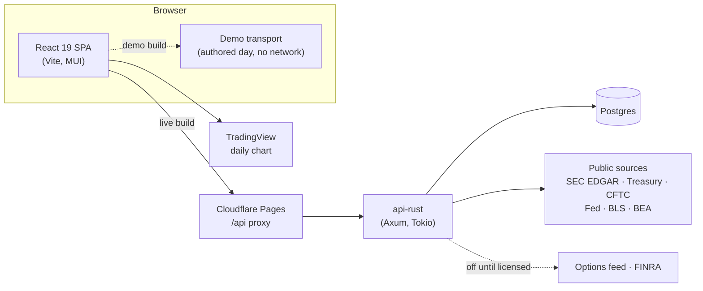

# Convexa

**See the dealer positioning behind the price.** Convexa turns a stock's option chain into dealer
gamma structure (the call and put walls, the gamma flip, the magnet), reads it alongside public
market data, and gives a risk-first read of the setup. Every trade is simulated.

**[Open the full demo →](https://staging.convexa.pages.dev)** · [Live site](https://convexa.pages.dev) ·
[How we read dealer structure](https://convexa.pages.dev/blog/how-we-read-dealer-structure)


> A personal portfolio project, built solo. It is not financial advice and places no real trades:
> positions and orders are simulated (paper), and a connected brokerage is read-only.

---

## Two sites, one codebase

| | [Demo](https://staging.convexa.pages.dev) | [Live site](https://convexa.pages.dev) |
|---|---|---|
| **What runs** | Every screen: the Scanner, the dealer-structure desk, AI reads, a simulated book, alerts and research | What is free and live: TradingView's daily chart, SEC filings and insider trades, Treasury rates, CFTC futures positioning, Fed liquidity, release calendars and the research notes |
| **Data** | One authored market day (Oct 7, 2026), in your browser | Real public sources, read by the Rust API; nothing is mocked |
| **Network** | Its own static files only: no API, server or third-party request, and an end-to-end check blocks and asserts every other request | The Pages site and its API on Railway |
| **What it says** | Every figure is tagged *Demo · sample data* | Every panel names its source and how late it is; panels that need a paid options feed say *Not live* and what they would show |

The dealer-structure engine needs a real-time options feed, which costs money a portfolio project
doesn't spend. Rather than fake it, the live site says so on every panel that would need it, and the
demo shows the whole product on an authored day.

---

## What's worth a look

**Honest data states, everywhere.** Each panel carries one state word from a closed list (*Updated*,
*Delayed by source*, *Last good copy*, *Not live*, *Off*, *Sample*…), with its source and timestamp.
Production mocks nothing; the demo never touches the network. When FINRA's display terms turned out to
need a credential the project doesn't have yet, FINRA data was switched off with the reason shown,
rather than shown without permission (`docs/public-data/FINRA-TERMS-2026-10-15.md`).

**A Rust API with a pinned contract.** The Axum API generates its OpenAPI document from the Rust
types; the TypeScript client is generated from that, and the artifacts' hashes are pinned, so a wire
change that skips the contract fails the build. Public-data reads use per-source caches that serve a
*last good copy* when a source fails, polite SEC access (a declared user agent and a request budget),
and time-bounded reads, so one slow filer can't hold a page.

**Real public data, checked against the filing.** The research notes' figures name the XBRL concept
they come from; a check compares each against the company's SEC filing (35 of 35 match today). The
FOMC decisions on the rates chart come from the Fed's own statements, each row citing its URL.

**A WebGL dealer-gamma surface.** The landing's hero is a WebGL2 surface of gamma across strike and
expiry, with a static projection as its designed fallback, rendering on demand inside a measured frame
budget, keyboard-operable, and still under reduced motion.

**A design system that drives the build.** The design lives as source (`design/src`): every screen has
boards for each environment and width plus a spec card listing what's built. A screen tracker is
generated from those cards, so "what's left" is never a hand-kept list. Binding rules (state words,
neutral charts, sign never by color alone, one amber primary action per screen) live in
`.spire/clusters/tech/context/DESIGN_SYSTEM.md`, with every change recorded as a dated amendment.

**Risk-based testing.** Tests exist where a silent failure would cost something: money, dates,
parsers, data writes, state words, account boundaries. About 3,400 automated tests today (2,053
front-end, 1,232 Rust, 86 API-client) plus Playwright journeys; in fix rounds, each new test is shown to
fail without its fix. A web-app audit of 83 practice fields was run against the deployed site, and four of
its top five fixes shipped.

---

## Architecture



- **`apps/api`**: Rust (Axum, Tokio), crate `api-rust`: analytics, server-sent events, auth and
  sessions, the synced paper book, public-data reads and caches. The quant engine is
  `libs/quant-engine`.
- **`apps/dashboard`**: React 19, Vite, MUI. One codebase builds both sites: `VITE_DATA_MODE=demo|live`.
- **`libs/api`**: the typed client, generated from the API's OpenAPI document, plus the in-browser
  demo transport.
- **`apps/dashboard-e2e`**: Playwright journeys, including the demo's zero-network check.
- Deploys: Cloudflare Pages builds `main` (live) and `staging` (demo); Railway runs the API from `main`.
- Monorepo: Nx 23.

---

## Run it locally

Needs Node (see `.nvmrc`) and npm; Rust only for the API.

```bash
npm ci
VITE_DATA_MODE=demo npm run serve:dashboard   # the demo at http://localhost:4200, no backend
```

With the API (copy `apps/api/.env.example` to `apps/api/.env` first; public data needs no keys, and
`MARKET_DATA_MODE=paused` runs without an options feed):

```bash
npm run dev            # API on :8000 and the site on :4200
```

Checks:

```bash
npm run verify         # affected lint, typecheck and tests, a secret scan, and the notes' filing check
npm run typecheck      # Vitest does not typecheck
git config core.hooksPath tools/hooks   # pre-push: secret scan, lint, typecheck
```

`npm run verify` and the pre-push hook need [gitleaks](https://github.com/gitleaks/gitleaks). GitHub
Actions is off for cost; the workflow files stay as the record, and verification runs locally.

---

## How it's built

Built solo with AI coding agents (Claude Code) working inside a structured delivery process: product
memory, contracts and the design system live in `.spire/clusters/tech/`; host adapters for each agent
live in `.claude/`, `.codex/` and `.grok/`. Decisions are dated and append-only; reviews are
adversarial; nothing ships without its checks passing locally. See `CLAUDE.md` and
`.spire/clusters/tech/context/PROJECT_CONTEXT.md`.

## License

MIT
