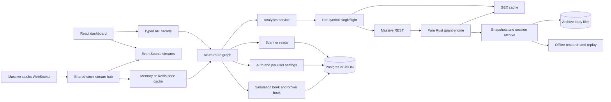
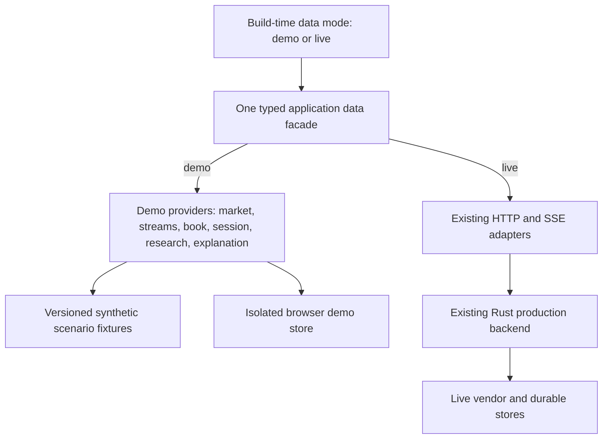

# Backend source audit for the portfolio demo

Observed 2026-10-07 (America/Los_Angeles). Git HEAD: `8932fc1176543eff3fa826de6924e12ec52f3310`. The scoped `git status --short -- apps/api libs/quant-engine libs/api` produced no changes during this audit. This report describes inspected source, not a running deployment. No server, vendor request, migration, or test suite was run.

## Executive finding

The existing backend is a substantial Rust modular monolith with two independent market-data paths, a pure quant library, generated API contracts, durable research capture, authentication, and simulation-book sync. It already has fixture and replay tools, but they are deliberately isolated from production. `MARKET_DATA_MODE=paused` stops market-data work; it does **not** populate a portfolio demonstration.

For the public portfolio, a browser-side demo adapter behind the existing `@convexa/api` facade is the lowest-cost deployment path. Select it once at application composition; keep every widget on the same typed data boundary; provide a parallel stream adapter and isolated demo storage. It can be hosted without the Rust process or vendor/database credentials. Preserve the backend's production restrictions and use its quant outputs/contracts to validate or generate the checked-in synthetic fixtures. If showcasing the backend running becomes a goal, add an explicit backend demo composition later rather than promoting capacity-test constructors to production.

## Evidence map and scale

The source inventory command found **188** Rust source files under `apps/api/src`, **56** Rust files under `apps/api/tests` (including one nested fixture helper), and **3** integration-test files under `libs/quant-engine/tests`. These are file counts, not passing-test counts. The checked-in OpenAPI document parses as **50 paths / 57 operations**, OpenAPI **3.1.0**; this audit did not regenerate or prove freshness of that artifact.

| Layer | Role | Source evidence |
| --- | --- | --- |
| Browser boundary | Typed ordinary HTTP via `openapi-fetch`; generated schema consumed by public facade | [client.ts](C:/Dev/convexa/libs/api/src/lib/client.ts:1), [convexa.ts](C:/Dev/convexa/libs/api/src/lib/convexa.ts:13) |
| HTTP application | Axum 0.8, Tokio, Tower HTTP CORS/tracing, serde, Utoipa | [Cargo.toml](C:/Dev/convexa/apps/api/Cargo.toml:24), [server.rs](C:/Dev/convexa/apps/api/src/server.rs:284) |
| Composition | `AppState` owns caches, live client, stores, broker service, auth, stream hub and research services | [state.rs](C:/Dev/convexa/apps/api/src/state.rs:265), [state.rs](C:/Dev/convexa/apps/api/src/state.rs:642) |
| Quant | Pure Rust GEX, greeks, signal scoring, IV/HV, VWAP, context and candidate calculations | [lib.rs](C:/Dev/convexa/libs/quant-engine/src/lib.rs:1) |
| Live I/O | Massive REST via reqwest/rustls; stocks WS via tokio-tungstenite; S3-compatible flat files | [rest.rs](C:/Dev/convexa/apps/api/src/infrastructure/massive/rest.rs:94), [ws.rs](C:/Dev/convexa/apps/api/src/infrastructure/massive/ws.rs:325), [client.rs](C:/Dev/convexa/apps/api/src/infrastructure/flatfiles/client.rs:1) |
| Persistence | Postgres/sqlx when enabled; otherwise local JSON or memory; optional Redis prices | [Cargo.toml](C:/Dev/convexa/apps/api/Cargo.toml:63), [state.rs](C:/Dev/convexa/apps/api/src/state.rs:498), [store.rs](C:/Dev/convexa/apps/api/src/services/auth/store.rs:602) |
| Research | Capture, replay, outcome joins, batch backtest, score lab; separated from trader path | [mod.rs](C:/Dev/convexa/apps/api/src/services/research/mod.rs:1) |

## System architecture: observed source



This is a code-derived topology, not a network discovery diagram. The dashboard also has a direct scanner EventSource outside the shared API facade; that is a required demo interception seam ([useLivePrices.ts](C:/Dev/convexa/apps/dashboard/src/app/pages/scanner/useLivePrices.ts:57)).

### Startup and configuration

1. `main` guards the host mode before loading dotenv, then configures `tracing_subscriber` ([main.rs](C:/Dev/convexa/apps/api/src/main.rs:379)). Dotenv preference is crate `.env`, workspace `.env`, then current-directory `.env`; a recognized `APP_ENV`/`CONVEXA_ENV` overlay is loaded without overriding values already set ([main.rs](C:/Dev/convexa/apps/api/src/main.rs:344)). Deployment values should therefore be explicit host environment variables rather than assuming an overlay overrides a base file.
2. `Config::from_env` reads `MARKET_DATA_MODE` before requiring `MASSIVE_API_KEY`. Accepted values are `live` and `paused`; unset defaults to live ([config.rs](C:/Dev/convexa/apps/api/src/config.rs:119), [config.rs](C:/Dev/convexa/apps/api/src/config.rs:216)). `DATA_FEED` selects realtime/delayed, which is independent of offline/demo behavior.
3. `APP_ENV=prod` validates production configuration, checks database/schema readiness and archive roots, constructs production state, builds routes, and binds the listener ([server.rs](C:/Dev/convexa/apps/api/src/server.rs:22)). A binary without the Postgres feature refuses that production profile ([server.rs](C:/Dev/convexa/apps/api/src/server.rs:69)).
4. Only after a successful bind, and only in live mode, it starts the stock-stream worker, Path-A tape capture, warmer, session-archive ensure worker and scanner ([server.rs](C:/Dev/convexa/apps/api/src/server.rs:95)). Paused mode starts none of them.
5. `serve_http_only` is already available for research replay without those producers ([server.rs](C:/Dev/convexa/apps/api/src/server.rs:140)). Replay explicitly refuses `APP_ENV=prod` ([state.rs](C:/Dev/convexa/apps/api/src/state.rs:905)); production fixture injection is also refused ([state.rs](C:/Dev/convexa/apps/api/src/state.rs:780)).

### Data and storage ownership

| Store | Contents and semantics | Demo implication |
| --- | --- | --- |
| `PriceCache` | Memory or Redis; Redis connect failure falls back to memory. Redis writes use `SET` without an expiration in this implementation. | Demo should use its own memory store and clock; never reuse a Redis URL. [price_cache.rs](C:/Dev/convexa/apps/api/src/infrastructure/redis/price_cache.rs:16), [price_cache.rs](C:/Dev/convexa/apps/api/src/infrastructure/redis/price_cache.rs:144) |
| `GexCache` + `GexFlight` | Per-process analytics cache with configured TTL and per-symbol singleflight; `peek` supports stale/read-only consumers. | Precomputed demo bundles can preserve consumer shape without invoking the live cache path. [state.rs](C:/Dev/convexa/apps/api/src/state.rs:1469), [analytics.rs](C:/Dev/convexa/apps/api/src/services/analytics.rs:46) |
| `ScanStore` | Rows, sweep heartbeat, cached bundles, structure samples; JSON/memory or Postgres. | Seed a consistent universe, row set, history and heartbeat together. [store.rs](C:/Dev/convexa/apps/api/src/services/scanner/store.rs:215) |
| `AuthStore` | Users, sessions, settings, encrypted credential material, Grok links; JSON or Postgres. | Public demo identity should be local and distinct from real accounts. Method `open_sqlite` misleadingly persists JSON, not SQLite. [store.rs](C:/Dev/convexa/apps/api/src/services/auth/store.rs:141), [store.rs](C:/Dev/convexa/apps/api/src/services/auth/store.rs:602) |
| `IvStore` | Historical IV samples; live analytics may write through when deriving IV rank. | Synthetic IV history belongs to demo fixtures, never the production store. [analytics.rs](C:/Dev/convexa/apps/api/src/services/analytics.rs:434) |
| Simulation `/api/book` | Per-user opaque FE v3 positions/orders/decisions JSON; Postgres server sync, latest client timestamp wins. Without Postgres, GET returns empty `source:none`; FE owns local storage. | Use a separate versioned demo storage namespace and reset operation. [book.rs](C:/Dev/convexa/apps/api/src/routes/book.rs:1), [book.rs](C:/Dev/convexa/apps/api/src/routes/book.rs:369), [book.rs](C:/Dev/convexa/apps/api/src/routes/book.rs:380) |
| Snapshot/archive/tape/flat files | Filesystem bodies plus JSON or Postgres metadata; separate roots and provenance. Some constructors plant conformance seeds or migrate inline archive bodies. | Do not boot ordinary state against existing production storage for fixture generation. [state.rs](C:/Dev/convexa/apps/api/src/state.rs:1247), [state.rs](C:/Dev/convexa/apps/api/src/state.rs:1317) |

The compiled migration source names 16 domain tables: users, sessions, user_settings, credentials, iv_samples, scan_rows, scan_heartbeat, scan_bundles, scan_structure_history, ai_rec_daily, user_book, structure_outcomes, grok_links, chain_snapshots, session_chain_archive and session_day_tape ([migrations.rs](C:/Dev/convexa/apps/api/src/db/migrations.rs:15)). This is the compiled schema intent, not an inspection of an actual database. Production uses schema validation before accepting traffic; database migrations require a separate authorized operation ([postgres.rs](C:/Dev/convexa/apps/api/src/db/postgres.rs:19)).

### HTTP and event surfaces

The route graph is centrally registered through handler-owned contracts and used for routing/OpenAPI ([mod.rs](C:/Dev/convexa/apps/api/src/routes/mod.rs:35)).

| Surface | Operations / consumers | Source anchor |
| --- | --- | --- |
| Health | `/health`, `/api/health`, `/api/_metrics` | [health.rs](C:/Dev/convexa/apps/api/src/routes/health.rs:249) |
| Price | `/api/price/{ticker}`, `/api/prices` | [price.rs](C:/Dev/convexa/apps/api/src/routes/price.rs:166) |
| Desk analytics | `/api/ticker/{ticker}`, `/api/market-data`, `/api/signals`, `/api/strike-profile`, `/api/personas` | [market.rs](C:/Dev/convexa/apps/api/src/routes/market.rs:781) |
| Contracts | `/api/contract/{ticker}`, `/api/candidates/{ticker}` | [contract.rs](C:/Dev/convexa/apps/api/src/routes/contract.rs:140), [candidates.rs](C:/Dev/convexa/apps/api/src/routes/candidates.rs:158) |
| Streams | `/api/ticker/{ticker}/progressive` (staged price/analytics), `/api/stream/{ticker}` (ticker updates), `/api/stream/prices` (batched watch prices) | [ticker.rs](C:/Dev/convexa/apps/api/src/routes/ticker.rs:200), [stream.rs](C:/Dev/convexa/apps/api/src/routes/stream.rs:408) |
| Screener | `/api/scan`, `/api/scan/all`, `/api/scan/universe`, `/api/scan/view`, `/api/scan/{symbol}/history` | [scan.rs](C:/Dev/convexa/apps/api/src/routes/scan.rs:388) |
| Identity/settings | Session, signup/login/logout, settings, AI key CRUD, Google OAuth, Grok linking | [auth.rs](C:/Dev/convexa/apps/api/src/routes/auth.rs:1132) |
| Portfolio | `/api/book` GET/PUT; broker credential CRUD, book, refresh | [book.rs](C:/Dev/convexa/apps/api/src/routes/book.rs:318), [broker.rs](C:/Dev/convexa/apps/api/src/routes/broker.rs:319) |
| Recommendation | POST recommendation, GET export/status, simulated-trade gate | [recommendation.rs](C:/Dev/convexa/apps/api/src/routes/recommendation.rs:546) |
| Operator research | Snapshot, session-book, tape, flat-file list/detail and archive coverage under `/api/_research/*` | [mod.rs](C:/Dev/convexa/apps/api/src/routes/mod.rs:70) |

Auth includes Argon2 password hashes, signed session cookies with addressed key rotation, AES-256-GCM stored credentials, and separate OAuth flows ([passwords.rs](C:/Dev/convexa/apps/api/src/services/auth/passwords.rs:8), [cookies.rs](C:/Dev/convexa/apps/api/src/services/auth/cookies.rs:51), [crypto.rs](C:/Dev/convexa/apps/api/src/services/auth/crypto.rs:94)). Router middleware applies rate limiting, CORS and HTTP tracing ([server.rs](C:/Dev/convexa/apps/api/src/server.rs:284)). Public demo flows should show local account/settings states and sample connections; they must not submit real credentials or invoke OAuth.

## Reusable provider seams and gaps

| Existing mechanism | What it actually does | Gap for complete public demo |
| --- | --- | --- |
| `MarketDataPort::{Live,Fixture}` | Resolves full vendor bundles and daily bars; fixture catalog supports multiple frozen as-of samples | Production analytics still resolves directly through Massive unless a harness fixture field is installed. Not a global production selector. [mod.rs](C:/Dev/convexa/apps/api/src/services/market_data/mod.rs:122), [analytics.rs](C:/Dev/convexa/apps/api/src/services/analytics.rs:224) |
| `compute_analytics_from_vendor` / `compute_from_port` | Shares real GEX/context calculations with offline research inputs | Useful fixture-authoring source of truth; compute alone does not seed auth, scanner, book, streams or research pages. [analytics.rs](C:/Dev/convexa/apps/api/src/services/analytics.rs:331), [analytics.rs](C:/Dev/convexa/apps/api/src/services/analytics.rs:537) |
| `StockStreamHub::fixture` / local hub | Local broadcast event producer without a live stock connection | Harness construction is not public deployment composition. Need browser stream adapter or an explicit demo server profile. [ws.rs](C:/Dev/convexa/apps/api/src/infrastructure/massive/ws.rs:83) |
| `PositionsProvider` trait | Env-selected `POSITIONS_PROVIDER`, defaults to deterministic stub | Stub still sits behind signed-in credential resolution; seeded broker data is not a fully seeded simulation book. Webull is a typed `adapter_fault` placeholder. [mod.rs](C:/Dev/convexa/apps/api/src/services/broker/mod.rs:93), [stub.rs](C:/Dev/convexa/apps/api/src/services/broker/stub.rs:1) |
| `AI_REC_LOCAL_ONLY=1` | Selects rule-based strategy construction instead of LLM HTTP | Usable key check runs first; it alone does not enable an unauthenticated free demo. Mock recommendation provider must return clearly labeled deterministic sample output. [recommendation.rs](C:/Dev/convexa/apps/api/src/services/recommendation.rs:775), [recommendation.rs](C:/Dev/convexa/apps/api/src/services/recommendation.rs:820) |
| Research replay | Dedicated CLI replays a tape through local hub and held analytics, provenance `session_tape` | One armed replay identity and deliberate prod refusal; do not repurpose as arbitrary multi-widget synthetic demo. [state.rs](C:/Dev/convexa/apps/api/src/state.rs:905), [player.rs](C:/Dev/convexa/apps/api/src/services/day_tape/player.rs:90) |
| `MARKET_DATA_MODE=paused` | No live market workers; analytics/cold-fetch/stream demand paths refuse with paused state | Stops acquisition; does not seed widgets. Its tests are a useful negative-network pattern. [server.rs](C:/Dev/convexa/apps/api/src/server.rs:96), [market_data_paused_no_vendor_contact.rs](C:/Dev/convexa/apps/api/tests/market_data_paused_no_vendor_contact.rs:48) |

A key nuance for facade design: ordinary HTTP already funnels through one adapter ([client.ts](C:/Dev/convexa/libs/api/src/lib/client.ts:5)), but ticker EventSource is constructed in the facade ([convexa.ts](C:/Dev/convexa/libs/api/src/lib/convexa.ts:1316)) and scanner EventSource is constructed in the dashboard ([useLivePrices.ts](C:/Dev/convexa/apps/dashboard/src/app/pages/scanner/useLivePrices.ts:57)). Replacing `fetch` alone cannot guarantee no outgoing calls.

## Existing technical analysis and research

Technical analysis is partly implemented already. `context_pack` computes EMA20/50 trend, Wilder ADX14 strength, Wilder RSI14 momentum, ATR5/14/30 as **simple mean true range**, GEX-profile concentration and flow-versus-positioning context. These reads are independently nullable and additive; they are attached after signals and must not silently change score/gate/fingerprint ([context_pack.rs](C:/Dev/convexa/libs/quant-engine/src/context_pack.rs:1), [analytics.rs](C:/Dev/convexa/apps/api/src/services/analytics.rs:424)). VWAP bands, historical volatility, IV skew/term structure, IV rank, straddle move and volatility-normalized GEX are also existing outputs ([lib.rs](C:/Dev/convexa/libs/quant-engine/src/lib.rs:45), [analytics.rs](C:/Dev/convexa/apps/api/src/services/analytics.rs:510)).

The API already returns market-context summary fields, not a dedicated general-purpose candle/indicator-history API. A chart-rich technical-analysis page therefore needs explicit candle/history models and associated data adapters. Do not invent MACD/Bollinger support as an existing backend feature: neither named implementation was found in the quant source searched for this audit. Preserve method/period labels, indicator warm-up states, demo as-of and deterministic symbol selection.

Research capabilities include structure sample capture, horizon outcome joins, score-lab baseline and leave-one-driver-out analyses, batch replay/backtest, replay outcome join, archive coverage, tape replay and retained flat files ([research/mod.rs](C:/Dev/convexa/apps/api/src/services/research/mod.rs:5), [main.rs](C:/Dev/convexa/apps/api/src/main.rs:121)). Most are CLI or operator surfaces, not a public research user journey. A portfolio research page should expose a curated synthetic scenario/read model, labeled with fixture provenance and sample limitations, without handing browser users an operator token or production archive endpoint.

## Five request and data-flow traces

These are **static source traces**. No timings, deployed behavior or observed request logs are claimed.

### 1. Open a ticker: independent price and analytics

```mermaid
sequenceDiagram
  participant D as Dashboard
  participant R as Axum ticker/market route
  participant P as Price cache
  participant A as Analytics service
  participant M as Massive REST
  participant Q as Quant engine
  D->>R: ticker bundle or progressive stream
  par Fast price
    R->>P: read symbol
    alt cold cache
      R->>M: quick stock snapshot
      R->>P: cache price
    end
  and Structure
    R->>A: load_analytics
    A->>A: replay hold / TTL cache / singleflight
    alt needs acquisition
      A->>M: chain + daily + minutes + optional trades
      A->>Q: compute GEX, signals, context
      Q-->>A: analytics snapshot
      A->>A: cache; capture where applicable
    end
  end
  R-->>D: typed bundle or staged SSE events
```

Entry: [market.rs](C:/Dev/convexa/apps/api/src/routes/market.rs:782), [ticker.rs](C:/Dev/convexa/apps/api/src/routes/ticker.rs:211). Cache/flight: [analytics.rs](C:/Dev/convexa/apps/api/src/services/analytics.rs:21). Four-way fetch and best-effort degradation: [analytics.rs](C:/Dev/convexa/apps/api/src/services/analytics.rs:258). Chain is required; missing daily/minutes/trades degrade their respective outputs. CPU work uses Tokio blocking tasks ([analytics.rs](C:/Dev/convexa/apps/api/src/services/analytics.rs:354)).

### 2. Open screener: background producers and cheap reads

Universe JSON → scanner boot → fast stock-snapshot loop updates spot/movement → slow batch calls `load_or_compute` → projection/tiering → rows, heartbeat, bundle/history persistence → `/api/scan` reads stored rows → scanner browser price stream overlays recent prices. Price-only fast ticks do not append structure samples. Sources: [universe.rs](C:/Dev/convexa/apps/api/src/services/scanner/universe.rs:39), [loop.rs](C:/Dev/convexa/apps/api/src/services/scanner/loop.rs:194), [loop.rs](C:/Dev/convexa/apps/api/src/services/scanner/loop.rs:457), [loop.rs](C:/Dev/convexa/apps/api/src/services/scanner/loop.rs:498), [scan.rs](C:/Dev/convexa/apps/api/src/routes/scan.rs:593). Demo should seed both row/history views and price events from one scenario.

### 3. Receive market updates: one vendor connection, many consumers

Massive WS authentication/subscription → decode event → shared hub broadcast → cache and tape capture consumers + SSE subscribers → per-symbol filtering/throttling → browser. SSE keeps request/task/admission lifetimes until the stream closes; prices batch on a timer and send heartbeat comments. Sources: [ws.rs](C:/Dev/convexa/apps/api/src/infrastructure/massive/ws.rs:325), [stream.rs](C:/Dev/convexa/apps/api/src/routes/stream.rs:436), [stream.rs](C:/Dev/convexa/apps/api/src/routes/stream.rs:458). Demo streams need deterministic timing, unsubscribe/cleanup and honest `live=false` provenance, not an EventSource pointing at the live origin.

### 4. Sign in and manage a portfolio

POST login → password verification → signed session cookie → authenticated `/api/book` → per-user Postgres blob or empty local-server envelope → browser reconciles its own simulation positions/orders. Separately, broker credential resolution → `BrokerBookService` per-user TTL/throttle cache → `PositionsProvider::fetch_book` → broker positions. Sources: [auth.rs](C:/Dev/convexa/apps/api/src/routes/auth.rs:1167), [book.rs](C:/Dev/convexa/apps/api/src/routes/book.rs:329), [service.rs](C:/Dev/convexa/apps/api/src/services/broker/service.rs:102), [service.rs](C:/Dev/convexa/apps/api/src/services/broker/service.rs:175). The two books are different domains and must not be collapsed into one seed.

### 5. Ask for an explanation or research a scenario

Recommendation request → optional/session-required route policy → resolved user AI preference/key → cached/derived market bundle + candidate/risk grounding → gate, cap and cooldown → deterministic local strategy **or** real LLM HTTP → grounded response envelope. LLM providers include Anthropic, OpenAI, xAI, Gemini and compatible endpoints ([llm.rs](C:/Dev/convexa/apps/api/src/services/llm.rs:12), [llm.rs](C:/Dev/convexa/apps/api/src/services/llm.rs:234)); provider output does not feed the quant score ([recommendation.rs](C:/Dev/convexa/apps/api/src/services/recommendation.rs:3)). Research instead takes captured fixtures/samples through offline joins and reports; it is not this online LLM path ([research/mod.rs](C:/Dev/convexa/apps/api/src/services/research/mod.rs:1)). Demo adapters should return separate, deterministic explanations and research scenarios with explicit provenance.

## Observability and verification boundaries

- Real facilities: Tower HTTP tracing, `tracing` phase logs including vendor/compute milliseconds, cache metrics, lifecycle/capacity probes, archive coverage and write telemetry, request-count instrumentation in the Massive client. See [server.rs](C:/Dev/convexa/apps/api/src/server.rs:297), [analytics.rs](C:/Dev/convexa/apps/api/src/services/analytics.rs:306), [state.rs](C:/Dev/convexa/apps/api/src/state.rs:351).
- The public operator metrics envelope currently **declares instrumentation disabled**, returns an empty `recent_traces` array and empty typed global metrics. Do not draw historical latency or throughput charts as if this were a working trace collector ([health.rs](C:/Dev/convexa/apps/api/src/routes/health.rs:649)).
- Existing tests cover generated contract graph/parity, route response conversion, runtime market/auth/research boundaries, production boot/schema restrictions, paused no-vendor-contact, fixture/replay isolation, quant golden cases and capacity harness behavior. Existence does not establish that these pass today: this audit ran no tests. Useful anchors: [api_contract_router.rs](C:/Dev/convexa/apps/api/tests/api_contract_router.rs:1), [market_data_paused_no_vendor_contact.rs](C:/Dev/convexa/apps/api/tests/market_data_paused_no_vendor_contact.rs:48), [golden.rs](C:/Dev/convexa/libs/quant-engine/tests/golden.rs:1).
- High-value added demo checks: a browser run that fails on any `/api`, vendor, broker, OAuth or LLM network contact; contract-shape and cross-widget consistency for a finite set of fixtures; local-store isolation/reset; stream teardown; one visitor journey across screener → ticker → simulated portfolio → technical analysis → research. Reuse existing backend tests without adding a test per static fixture field.

## Recommended demo boundary and tradeoffs



Recommended selector is a single application mode such as `VITE_DATA_MODE=demo|live`, validated strictly at build/composition time. In Vite that changes a build artifact, so switching requires rebuild/redeploy; it is not a server environment switch applied after static assets were built. If runtime env switching is required, use a small validated runtime configuration file initialized before providers, and include that file in the deployment contract. Neither proposed mechanism exists yet.

Choose a domain provider/facade interface instead of seeding isolated components. Ordinary facade operations must retain generated contract types; demo metadata should be explicit. Keep live and demo persistence namespaces distinct, use a fixed scenario clock, and make unknown symbols return a defined unsupported-demo state rather than silently falling back to live. Never add a production API token to the frontend bundle. For native browser features outside ordinary HTTP—EventSource, OAuth redirects and file/export actions—provide an explicit demo implementation or honest unavailable state.

Tradeoff: a static portfolio is cheap, fast and independent of credentials, but proves frontend workflows plus source-described backend architecture; it does not prove the Rust service is running for visitors. A separately deployed backend demo can demonstrate real quant/request behavior but requires explicit safe composition, isolated stores, schema/runtime policy work, stream seeding and hosting. The current code supports building that later without discarding the facade approach.

## Remaining facts to verify before implementation or deployment

1. The frontend audit must enumerate all direct `fetch`, EventSource, WebSocket, OAuth/navigation, persistence and export seams; the two confirmed EventSource sites above show that one transport replacement is insufficient.
2. The new technical-analysis and public research surfaces need design canvas/read-model decisions before UI build, because current research APIs are operator-oriented and current technical analysis is primarily summary context.
3. Decide whether fixture analytics are generated with the real quant engine or hand-authored contract fixtures; tag their provenance and validate numeric consistency accordingly. Avoid republishing paid historical data as synthetic demo data.
4. Verify current build/CI/deployment configuration separately. No Nx target, test, build, release, deployed URL or production database was exercised by this source audit.
