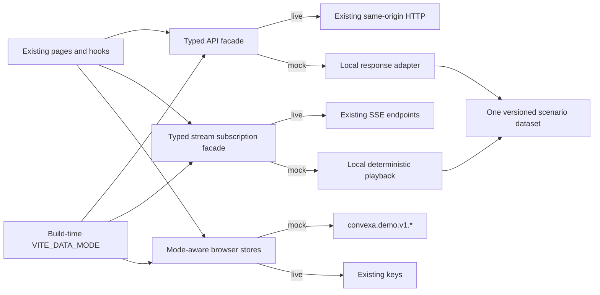

# Frontend source audit for the portfolio demo

Source audit performed 2026-10-07 against Git HEAD `8932fc11`. This is observed source behavior and proposed design, not a runtime verification receipt. No vendor calls or application/test executions were performed for this audit.

## Finding

The smallest coherent zero-backend demo boundary is the existing `@convexa/api` facade, plus a shared stream adapter and mode-aware browser persistence. Ordinary HTTP already passes through one transport. Two SSE constructors, one operator research client, and two OAuth navigation actions bypass it. Changing just the ticker HTTP response would leave several widgets empty, preserve live-data claims, and risk mixing demo positions with a real browser book.

Technical analysis partly exists: the Market Context widget already displays computed EMA20/50, ADX14, RSI14 and ATR summaries. A public chart workspace with OHLC bars and a public research route do not exist. `/_ops/research` is a separate operator tool and must remain separate.

## Current route and data ownership

| Surface | Current data path | Source evidence |
|---|---|---|
| Application shell / identity / account controls | `AuthProvider` immediately renders children, then reads session; settings come from the session response. Signed-in identity starts a best-effort durable book pull. | [AuthContext.tsx:96](C:/Dev/convexa/apps/dashboard/src/app/features/auth/AuthContext.tsx:96), [AuthContext.tsx:139](C:/Dev/convexa/apps/dashboard/src/app/features/auth/AuthContext.tsx:139) |
| `/` landing, `/blog`, `/methodology`, fallback route | Static page content; landing warms route chunks without market-data fetches. Shell session read still applies. | [Landing.tsx:11](C:/Dev/convexa/apps/dashboard/src/app/pages/landing/Landing.tsx:11), [BlogPage.tsx:3](C:/Dev/convexa/apps/dashboard/src/app/pages/blog/BlogPage.tsx:3), [MethodologyPage.tsx:3](C:/Dev/convexa/apps/dashboard/src/app/pages/methodology/MethodologyPage.tsx:3) |
| `/ticker/:ticker` | `useTickerPageModel` composes REST bundle, ticker SSE, structure history, universe membership. Bundle polls every 60 seconds; stream updates an external store. Portfolio, personas, orders and AI remain separate owners. | [useTickerPageModel.ts:40](C:/Dev/convexa/apps/dashboard/src/app/pages/ticker/useTickerPageModel.ts:40), [useTickerBundle.ts:15](C:/Dev/convexa/apps/dashboard/src/app/pages/ticker/useTickerBundle.ts:15), [TickerDashboard.tsx:501](C:/Dev/convexa/apps/dashboard/src/app/pages/ticker/TickerDashboard.tsx:501) |
| `/positions` | Auth-gated; focused ticker bundle plus one ticker SSE; per-contract marks and per-other-ticker spot reads; local simulated book and orders; broker read-only book; derived track record. | [app.tsx:162](C:/Dev/convexa/apps/dashboard/src/app/app.tsx:162), [PositionsPage.tsx:103](C:/Dev/convexa/apps/dashboard/src/app/pages/positions/PositionsPage.tsx:103), [useContractLive.ts:16](C:/Dev/convexa/apps/dashboard/src/app/features/trading/positions/useContractLive.ts:16), [useTickerSpots.ts:39](C:/Dev/convexa/apps/dashboard/src/app/features/trading/model/useTickerSpots.ts:39) |
| `/scanner` (existing screener) | Auth-gated; one structure poll every 30 seconds; one price SSE for visible symbols; filters/sort in URL; saved view resides behind API. | [app.tsx:168](C:/Dev/convexa/apps/dashboard/src/app/app.tsx:168), [useScan.ts:61](C:/Dev/convexa/apps/dashboard/src/app/pages/scanner/useScan.ts:61), [Scanner.tsx:136](C:/Dev/convexa/apps/dashboard/src/app/pages/scanner/Scanner.tsx:136) |
| Command palette | One `getScan()` per palette open; no independent ambient polling; recent ticker store supplies navigation history. | [usePaletteScan.ts:10](C:/Dev/convexa/apps/dashboard/src/app/shell/CommandPalette/usePaletteScan.ts:10), [recentTickers/store.ts:9](C:/Dev/convexa/apps/dashboard/src/app/pages/ticker/recentTickers/store.ts:9) |
| `/alerts` | Browser-local rules and event history; ticker's successful REST snapshots drive evaluation. Browser notification permission is actual platform permission. | [AlertsPage.tsx:241](C:/Dev/convexa/apps/dashboard/src/app/pages/alerts/AlertsPage.tsx:241), [TickerDashboard.tsx:571](C:/Dev/convexa/apps/dashboard/src/app/pages/ticker/TickerDashboard.tsx:571), [alerts/store.ts:79](C:/Dev/convexa/apps/dashboard/src/app/features/alerts/store.ts:79) |
| `/settings` | User settings/risk inputs; local anonymous prefs; persona customization; AI provider credential/bootstrap controls; broker credentials. OAuth controls navigate outside ordinary fetch. | [AuthContext.tsx:169](C:/Dev/convexa/apps/dashboard/src/app/features/auth/AuthContext.tsx:169), [BrokerageSection.tsx:59](C:/Dev/convexa/apps/dashboard/src/app/features/auth/BrokerageSection.tsx:59), [AiKeySection.tsx:249](C:/Dev/convexa/apps/dashboard/src/app/features/auth/AiKeySection.tsx:249) |
| `/lab/*` | Existing chart experiments. Structure Field Lab optionally fetches the SPY ticker bundle; static sample controls also exist. | [app.tsx:180](C:/Dev/convexa/apps/dashboard/src/app/app.tsx:180), [StructureFieldLab.tsx:71](C:/Dev/convexa/apps/dashboard/src/app/pages/lab/StructureFieldLab.tsx:71) |
| `/_ops/metrics` | Operator-only layout; read-only `/api/_metrics` poll drives stage timing tables, recent traces and an ephemeral latency trend. | [app.tsx:129](C:/Dev/convexa/apps/dashboard/src/app/app.tsx:129), [useLatencyTrend.ts:91](C:/Dev/convexa/apps/dashboard/src/app/pages/operator-metrics/useLatencyTrend.ts:91) |
| `/_ops/research` | Operator-only layout; explicit absolute service base and operator token, coverage/list/load requests. No normal session cookie is sent. | [app.tsx:130](C:/Dev/convexa/apps/dashboard/src/app/app.tsx:130), [researchClient.ts:43](C:/Dev/convexa/apps/dashboard/src/app/pages/operator-session-archive/researchClient.ts:43) |

The route table lazy-loads all pages except Landing ([app.tsx:53](C:/Dev/convexa/apps/dashboard/src/app/app.tsx:53)). Primary navigation is four links: Scanner, Ticker, Positions, Alerts; operator links are deliberately absent ([TopNav.tsx:58](C:/Dev/convexa/apps/dashboard/src/app/shell/TopNav.tsx:58)). No separate watchlist/wishlist store or public research/technical-analysis route was found in production frontend source.

## Ticker widget matrix

All REST fields below belong to the `TickerBundle` returned by `GET /api/ticker/{ticker}`. Do not independently invent each widget's numbers: generate one internally consistent scenario snapshot and project it into these fields.

| Widget / interaction | Data required | Wiring evidence |
|---|---|---|
| Command deck, price, regime, tier, timestamps, expiry picker, quick symbols | `market_state`, `signals`, `meta.freshness`, `expirations`; SSE mid/last trade; universe membership; persona preferences | [TickerDashboard.tsx:838](C:/Dev/convexa/apps/dashboard/src/app/pages/ticker/TickerDashboard.tsx:838) |
| Structure field / price ladder / tape trail | `market_state`, `strike_profile.strikes`; ticker stream for tape only | [TickerDashboard.tsx:926](C:/Dev/convexa/apps/dashboard/src/app/pages/ticker/TickerDashboard.tsx:926) |
| Structure history path | `/api/scan/{symbol}/history?limit=48` samples, basis, loading/error state | [useStructureHistory.ts:8](C:/Dev/convexa/apps/dashboard/src/app/pages/ticker/useStructureHistory.ts:8), [convexa.ts:1268](C:/Dev/convexa/libs/api/src/lib/convexa.ts:1268) |
| Read strip | Market state, off-exchange summary, volume/OI threshold and unusual-strike count, score/tier, IV rank, setups count | [TickerDashboard.tsx:939](C:/Dev/convexa/apps/dashboard/src/app/pages/ticker/TickerDashboard.tsx:939) |
| AI read + full-analysis drawer | Recommendation status; on-demand recommendation POST; canonical personas; AI provider bootstrap; pinned bundle and open-position digest; export GET | [useAiRecommendation.ts:94](C:/Dev/convexa/apps/dashboard/src/app/pages/ticker/widgets/ai-rec/useAiRecommendation.ts:94), [useAiRecommendation.ts:179](C:/Dev/convexa/apps/dashboard/src/app/pages/ticker/widgets/ai-rec/useAiRecommendation.ts:179), [StateExportDrawer.tsx:124](C:/Dev/convexa/apps/dashboard/src/app/pages/ticker/widgets/ai-rec/StateExportDrawer.tsx:124) |
| Live tape | SSE payload and REST anchor; uses the shared liveness predicate | [TickerDashboard.tsx:1016](C:/Dev/convexa/apps/dashboard/src/app/pages/ticker/TickerDashboard.tsx:1016), [liveClaim.ts:52](C:/Dev/convexa/apps/dashboard/src/app/shared/liveness/liveClaim.ts:52) |
| Position brief | Shared portfolio derived views for ticker; storage health; simulation gate | [TickerDashboard.tsx:1025](C:/Dev/convexa/apps/dashboard/src/app/pages/ticker/TickerDashboard.tsx:1025) |
| Sim orders / order detail | Separate local orders store, contract marks, ticker stream, decision records; order engine drives fills | [TickerDashboard.tsx:1035](C:/Dev/convexa/apps/dashboard/src/app/pages/ticker/TickerDashboard.tsx:1035), [useOrderEngine.ts:94](C:/Dev/convexa/apps/dashboard/src/app/features/trading/orders/useOrderEngine.ts:94) |
| Dealer flow projection | `market_state.dealer_flow_projection` only | [TickerDashboard.tsx:1146](C:/Dev/convexa/apps/dashboard/src/app/pages/ticker/TickerDashboard.tsx:1146) |
| Market Context | `market_state.market_context`: trend/momentum, GEX shape, flow vs positioning, ATR | [TickerDashboard.tsx:1149](C:/Dev/convexa/apps/dashboard/src/app/pages/ticker/TickerDashboard.tsx:1149), [convexa.ts:98](C:/Dev/convexa/libs/api/src/lib/convexa.ts:98) |
| Term Structure | `market_state.term_structure`, REST age | [TickerDashboard.tsx:1151](C:/Dev/convexa/apps/dashboard/src/app/pages/ticker/TickerDashboard.tsx:1151) |
| Straddle Move | `market_state.straddle_move` | [TickerDashboard.tsx:1165](C:/Dev/convexa/apps/dashboard/src/app/pages/ticker/TickerDashboard.tsx:1165) |
| Fresh Positioning | `chain_vol_oi_ratio`, unusual strikes, threshold, REST age | [TickerDashboard.tsx:1169](C:/Dev/convexa/apps/dashboard/src/app/pages/ticker/TickerDashboard.tsx:1169) |
| Off-exchange blocks | `off_exchange`, REST age; mounted when dark-pool toggle is on | [TickerDashboard.tsx:1176](C:/Dev/convexa/apps/dashboard/src/app/pages/ticker/TickerDashboard.tsx:1176) |
| Setups | `signals.setups`, REST age | [TickerDashboard.tsx:1182](C:/Dev/convexa/apps/dashboard/src/app/pages/ticker/TickerDashboard.tsx:1182) |
| Trade-entry dialog | Expiries/strikes from bundle; contract lookup on selection; simulated book write after auth gate | [TradeEntryDialogView.tsx:250](C:/Dev/convexa/apps/dashboard/src/app/features/trading/tradeEntry/TradeEntryDialogView.tsx:250), [useTickerTradeFlows.ts:146](C:/Dev/convexa/apps/dashboard/src/app/pages/ticker/useTickerTradeFlows.ts:146) |
| Add-widget slot, context-category buttons | Intentionally inert “coming soon” affordances, no provider to seed | [TickerDashboard.tsx:1044](C:/Dev/convexa/apps/dashboard/src/app/pages/ticker/TickerDashboard.tsx:1044) |

`IvRank` remains implemented but is unmounted from the context band because the read strip owns that value ([TickerDashboard.tsx:1156](C:/Dev/convexa/apps/dashboard/src/app/pages/ticker/TickerDashboard.tsx:1156)). Do not re-add duplicate widgets just to display fixtures.

## Complete ordinary HTTP facade inventory

There are **30 HTTP call sites** in `convexa.ts` + `broker.ts`, all using [client.ts:5](C:/Dev/convexa/libs/api/src/lib/client.ts:5). The demo transport must account for every method/path pair, including currently unmounted exported calls. Unknown demo operations should return a typed unsupported response and never fall through to network.

| Methods and routes | Consumer / required demo behavior | Facade evidence |
|---|---|---|
| GET `/api/auth/session`; POST `/api/auth/signup`, `/api/auth/login`, `/api/auth/logout` | Demo persona bootstrap; no real account creation or credential collection. Public entry must reach auth-gated Scanner/Positions without a paid backend. | [convexa.ts:1067](C:/Dev/convexa/libs/api/src/lib/convexa.ts:1067) |
| PUT `/api/auth/settings` | Persist demo preferences/risk settings in demo namespace and return complete settings shape. | [convexa.ts:1126](C:/Dev/convexa/libs/api/src/lib/convexa.ts:1126) |
| POST `/api/positions/sim-trade/gate` | Locally authorize simulation only; preserve live implementation unchanged. | [convexa.ts:1147](C:/Dev/convexa/libs/api/src/lib/convexa.ts:1147) |
| GET `/api/scan`, `/api/scan/universe`, `/api/scan/view`; PUT `/api/scan/view` | Seed consistent rows/universe/default view; view edits survive within demo storage. Command palette shares rows. | [convexa.ts:1217](C:/Dev/convexa/libs/api/src/lib/convexa.ts:1217) |
| GET `/api/scan/{symbol}/history` | Meaningful historical samples for ticker path; consistent with scenario walls/flip. | [convexa.ts:1268](C:/Dev/convexa/libs/api/src/lib/convexa.ts:1268) |
| GET `/api/ticker/{ticker}` | Full bundle, honoring expirations/DTE/dark-pool/position query shape. Unsupported symbols resolve honestly. | [convexa.ts:1336](C:/Dev/convexa/libs/api/src/lib/convexa.ts:1336) |
| GET `/api/contract/{ticker}` | Coherent marks/Greeks for each seeded position leg and trade-entry selection. | [convexa.ts:1389](C:/Dev/convexa/libs/api/src/lib/convexa.ts:1389) |
| GET `/api/candidates/{ticker}` | Exported typed seam; no current production frontend caller found. Include compatible seeded response for API completeness. | [convexa.ts:302](C:/Dev/convexa/libs/api/src/lib/convexa.ts:302) |
| GET `/api/_metrics` | Operator-only sample receipt/typed unavailable; never fabricate production performance. | [convexa.ts:1438](C:/Dev/convexa/libs/api/src/lib/convexa.ts:1438) |
| GET/PUT/DELETE `/api/auth/ai-key`; DELETE `/api/auth/grok` | Bootstrap deterministic sample-analysis availability; never ask for/store actual API keys in the public demo. Key writes should refuse with explicit demo copy. | [convexa.ts:2010](C:/Dev/convexa/libs/api/src/lib/convexa.ts:2010) |
| GET/PUT `/api/book` | Demo book copy only; never import into, or push from, existing live namespace. | [convexa.ts:2080](C:/Dev/convexa/libs/api/src/lib/convexa.ts:2080) |
| POST `/api/recommendation/{ticker}`; GET `/api/recommendation/status/{ticker}`, `/api/recommendation/export/{ticker}` | Preauthored analysis tied to current scenario/candidate IDs; no LLM call; clearly labeled sample analysis; preserve grounding/provenance fields. | [convexa.ts:2104](C:/Dev/convexa/libs/api/src/lib/convexa.ts:2104), [convexa.ts:2133](C:/Dev/convexa/libs/api/src/lib/convexa.ts:2133) |
| GET `/api/personas` | Nonempty canonical persona catalog; existing offline presets are fallback. | [convexa.ts:2176](C:/Dev/convexa/libs/api/src/lib/convexa.ts:2176) |
| GET/PUT/DELETE `/api/broker/credential` | Explicitly unavailable credential connection in demo; no real secrets accepted. | [broker.ts:241](C:/Dev/convexa/libs/api/src/lib/broker.ts:241) |
| GET `/api/broker/book`; POST `/api/broker/book/refresh` | Clearly labeled sample read-only holdings if broker tab is showcased; refresh is local only; never a real-order path. | [broker.ts:277](C:/Dev/convexa/libs/api/src/lib/broker.ts:277) |

Transport exceptions to close explicitly:

1. Ticker `new EventSource('/api/stream/{ticker}?...')`: [convexa.ts:1306](C:/Dev/convexa/libs/api/src/lib/convexa.ts:1306). Preserve subscribe/unsubscribe lifecycle behind a provider.
2. Scanner `new EventSource('/api/stream/prices?symbols=...')`: [useLivePrices.ts:57](C:/Dev/convexa/apps/dashboard/src/app/pages/scanner/useLivePrices.ts:57). Move creation behind the same stream boundary; keep one subscription for visible names, merge semantics, watchdog and cleanup.
3. Operator research direct `fetch(absoluteBase + path)` with explicit token and `credentials: 'omit'`: [researchClient.ts:43](C:/Dev/convexa/apps/dashboard/src/app/pages/operator-session-archive/researchClient.ts:43). Routes are coverage, symbol session-book list and dated book load ([researchClient.ts:3](C:/Dev/convexa/apps/dashboard/src/app/pages/operator-session-archive/researchClient.ts:3)). Disable network-backed operator actions in public demo or supply separately labeled local examples.
4. Google OAuth navigation: [GoogleButton.tsx:49](C:/Dev/convexa/apps/dashboard/src/app/features/auth/GoogleButton.tsx:49). Demo availability must be false and handler must not navigate.
5. Grok OAuth navigation: [AiKeySection.tsx:249](C:/Dev/convexa/apps/dashboard/src/app/features/auth/AiKeySection.tsx:249). Demo availability must be false and handler must not navigate.

## Persistence and computed state

| State | Current location / behavior | Demo requirement |
|---|---|---|
| Simulated positions, decisions, saved position views | `convexa.positions.v3`; migration reads `convexa.positions.v2`, `convexa.ghost-trade.v1` and `gammaflow.*` legacy keys; touch timestamp `convexa.positions.touch_at`. Read faults block writes. [store.ts:60](C:/Dev/convexa/apps/dashboard/src/app/features/trading/positions/store.ts:60), [store.ts:235](C:/Dev/convexa/apps/dashboard/src/app/features/trading/positions/store.ts:235) | Mode-aware keys for **all** read/write/migration paths; demo must never fall back to live legacy keys. Seed before first page hydration. |
| Durable book sync | Session effect pulls; local book exports and pushes via latest-wins timestamp. [AuthContext.tsx:139](C:/Dev/convexa/apps/dashboard/src/app/features/auth/AuthContext.tsx:139), [bookSync.ts:9](C:/Dev/convexa/apps/dashboard/src/app/features/trading/positions/bookSync.ts:9) | Demo GET/PUT always local; no real cookie/remote book. Seed/pull ordering must not overwrite user demo edits. |
| Pending/filled/cancelled sim orders | `convexa.orders.v1`, separate fault latch. [orders/store.ts:19](C:/Dev/convexa/apps/dashboard/src/app/features/trading/orders/store.ts:19) | Separate demo key, coherent links to seeded decisions/positions. Preserve independent fault handling. |
| Track record / archive / export | Derived from v1/v2/v3 positions and orders sources; not a second independent ledger store. [outcomes/sources.ts:80](C:/Dev/convexa/apps/dashboard/src/app/features/trading/outcomes/sources.ts:80) | Source enumeration must use the same mode-aware keys; never combine real and demo outcomes. |
| P/L sparklines / session delta | Ephemeral buffers, at most 240 samples / 60 minutes; reload clears. [useTrends.ts:13](C:/Dev/convexa/apps/dashboard/src/app/features/trading/positions/useTrends.ts:13) | Not a durable key. A populated immediate demo chart needs an explicitly simulated series seed or enough playback samples, not fabricated live history. |
| Alert rules / event history | `convexa.alerts.v1`; read-fault preservation latch. [types.ts:47](C:/Dev/convexa/apps/dashboard/src/app/features/alerts/types.ts:47), [alerts/store.ts:22](C:/Dev/convexa/apps/dashboard/src/app/features/alerts/store.ts:22) | Dedicated demo namespace; seed illustrative rules/events; do not request notifications automatically. |
| Custom personas / active persona | `convexa.personas.v1`, old `gammaflow.personas.v1`; presets in code. [personas/store.ts:9](C:/Dev/convexa/apps/dashboard/src/app/features/personas/store.ts:9) | Namespace both current and legacy resolution. |
| Anonymous UI prefs / first-paint theme | `convexa.uiprefs.v1`, old `gammaflow.uiprefs.v1`, `convexa.theme-paint`. [localPrefs.ts:15](C:/Dev/convexa/apps/dashboard/src/app/features/auth/localPrefs.ts:15), [firstPaintTheme.ts:12](C:/Dev/convexa/apps/dashboard/src/app/features/auth/firstPaintTheme.ts:12) | Scope mode consistently, including pre-React theme read. |
| Recent tickers | `convexa.recent-tickers.v1`. [recentTickers/store.ts:9](C:/Dev/convexa/apps/dashboard/src/app/pages/ticker/recentTickers/store.ts:9) | Demo namespace, supported-symbol seed. |
| Scanner view | Server-owned; no localStorage in hook. Filters/sort URL-backed. [useScan.ts:26](C:/Dev/convexa/apps/dashboard/src/app/pages/scanner/useScan.ts:26) | Demo API owns isolated local persistence; keep URL filter behavior. |

Existing test-account seeding is **not** a production demo provider. It depends on `demo@convexa.io`, writes into the existing shared positions key, and contains fixed August/September 2026 expirations ([testSeed.ts:22](C:/Dev/convexa/apps/dashboard/src/app/features/trading/positions/testSeed.ts:22), [testSeed.ts:43](C:/Dev/convexa/apps/dashboard/src/app/features/trading/positions/testSeed.ts:43)). Its “server stores none” comment is stale relative to actual `bookSync`. Preserve it for live/dev behavior; introduce a distinct public demo seed/session.

## Proposed coherent boundary

Use `VITE_DATA_MODE=mock|live` as an explicit validated selection. In Vite this is build-time configuration: changing the environment requires rebuilding/redeploying unless a separate runtime config file is deliberately introduced. Preserve absent variable as current live behavior for compatibility; portfolio deployment sets mock explicitly. Unknown values should fail build/start rather than silently picking live.

Keep UI components unaware of response fixture construction. A local `Request -> Response` adapter at the existing HTTP seam preserves generated API typing and projections, while avoiding dozens of per-widget conditionals. Extract stream constructors behind typed facades rather than replacing browser globals. Scenario module must be lazy-loaded only in mock mode, contain no test framework imports, and reject unknown operations without network fallback.

Use one versioned dataset: supported symbols, consistent ticker/bars/option chains/candidates/scan rows/contract marks, book/open and closed positions, orders/decision linkage, history, personas, alerts and authored analysis. Choose either a fixed **explicitly dated scenario** or a coherent relative simulation clock; do not independently call `Date.now()` to relabel old prices as current market facts. Seed only absent demo keys and record a demo seed version; preserve explicit user deletions and corrupt-store refusal behavior. A reset action resets only enumerated demo keys.

### Critical liveness and simulation gap

Current `isDeliveringLive` intentionally refuses historical `session_tape`, closed market and offline payloads ([liveClaim.ts:52](C:/Dev/convexa/apps/dashboard/src/app/shared/liveness/liveClaim.ts:52)). `genuineIsLive` and `displayActive` similarly separate paid-live execution from replay display ([sessionTapeStanding.ts:39](C:/Dev/convexa/apps/dashboard/src/app/pages/ticker/sessionTapeStanding.ts:39)). Orders and market fills rely on live eligibility. Setting synthetic payloads to `live:true` just to animate/fill would mislabel the demo. Reusing `session_tape` for synthetic data would falsely imply a recorded session.

Add explicit demo provenance and a clear “Demo data / simulated playback” presentation. Separate figure display eligibility, simulated execution eligibility and genuine-market liveness. Any demo execution stays local; genuine-live chips/pulses remain off. Amend affected data-motion design rules intentionally if simulated playback should animate. Seed orders/history that render correctly before deciding whether automatic demo fills are in scope.

### New technical analysis and public research

- Build a separately routed public workspace (for example `/research/:ticker` with Technical analysis and Research tabs) rather than expose the operator session archive. Final route/navigation choice belongs in design/spec.
- Reuse Market Context's definitions where applicable: EMA20/50, Wilder RSI14, ADX14, ATR5/14/30 ([convexa.ts:52](C:/Dev/convexa/libs/api/src/lib/convexa.ts:52), [MarketContext.tsx:36](C:/Dev/convexa/apps/dashboard/src/app/pages/ticker/widgets/market-context/MarketContext.tsx:36)). Existing widget intentionally has no raw OHLC/series chart; this is an additive user-facing surface.
- Define an explicit bars/research provider API and provenance. Demo bars and indicators must agree mathematically. Live mode needs a real backend contract/adapter before presenting live data; frontend cannot invent a currently nonexistent HTTP endpoint or compute a fake live response.
- Research can begin with authored scenario thesis, catalysts, risks and notes grounded in the same sample market snapshot. Label synthetic company/news content as sample material; no invented current citations or claims of live AI research.
- Design visible loading, unsupported-symbol, missing-series, demo, live, offline/stale and analysis-unavailable states before implementation. Add route-level lazy loading so the chart/research code does not inflate landing startup.

## Reusable fixtures and verification seams

Existing Playwright data has a dense book, scanner rows, bundle, produced recommendation and per-contract marks ([scenarios.ts:299](C:/Dev/convexa/apps/dashboard-e2e/src/quality/fixtures/scenarios.ts:299), [scenarios.ts:325](C:/Dev/convexa/apps/dashboard-e2e/src/quality/fixtures/scenarios.ts:325)). It is an example/shape source, not production data: fixture time is fixed to August 23, 2026, several families are empty, and HTTP matching often hardcodes exact SPY query strings.

The strict fixture blocks unrecognized API paths and nonlocalhost egress ([strict-fixture.ts:124](C:/Dev/convexa/apps/dashboard-e2e/src/quality/fixtures/strict-fixture.ts:124)); this is a strong pattern for the production-demo browser test. It also provides real EventSource payload/gap cases. `features/auth/testBackend.ts` imports Vitest directly ([testBackend.ts:25](C:/Dev/convexa/apps/dashboard/src/app/features/auth/testBackend.ts:25)); never import it into runtime code.

Keep CI tests for failures that would silently ship: mock egress leak, live/mock namespace cross-contamination, mode build caching collision, missing provider branch, malformed seeded contract/position arithmetic, false-live claim, new chart indicator math, and one built-site end-to-end journey through Scanner -> Ticker -> simulated trade/Positions -> Research. Reuse existing accessibility and responsive browser gates; avoid duplicating a snapshot test for every data field. Build/typecheck must run separately from Vitest as the repository requires.

## Design source conventions

The binding authority is [.spire/clusters/tech/context/DESIGN_SYSTEM.md:9](C:/Dev/convexa/.spire/clusters/tech/context/DESIGN_SYSTEM.md:9). `docs/design/DESIGN_SYSTEM.md` is a pointer stub, not a second canon. Product tokens live in `apps/dashboard/src/app/shared/theme/tokens.ts`; `design/tokens/tokens.json` is a verified design mirror.

New surfaces should be added to `design/src/screens/*.mjs` and its screen registry, with artboards registered in [canvas.config.mjs:13](C:/Dev/convexa/design/src/canvas.config.mjs:13). `node design/src/build.mjs` generates static previews and canvas artboards ([build.mjs:1](C:/Dev/convexa/design/src/build.mjs:1)); never hand-edit `design/site` or `design/canvas`. Existing artboards cover responsive widths, user flows, dialogs, states, light/dark and component library. Preview sample values are explicitly not product truth.

Relevant binding visual rules: Curvature Terminal v2, three existing fonts, named theme tokens, 4-point spacing ladder, six page bands/container queries; figure cells rather than colored-edge stat tiles; live/static isolation; keyboard/tap access for hover affordances; truthful figure authorship; explicit missing-data vocabulary. Synthetic data must never acquire a “live” chip merely because a timer is running ([DESIGN_SYSTEM.md:228](C:/Dev/convexa/.spire/clusters/tech/context/DESIGN_SYSTEM.md:228)). New navigation affects the current four-link canon and requires a recorded intentional amendment, not an accidental fifth link.

## Fixture reuse caution (follow-up source inspection)

Existing test fixtures are response-shape references, not a complete demo catalog. In particular, the broker fixture file explicitly labels its captured-record section (from baseline line 149) as mirroring the owner's real Webull capture: `POS_CAPTURE_*`, `POS_CB_*`, and `BOOK_CAPTURED_COMPLETE` must never enter a public sample build. Author new synthetic holdings and account labels. The earlier small synthetic factories can inform types without reusing captured values.

`features/auth/testBackend.ts` imports Vitest; extract the typed bundle/candidate shapes rather than importing it into production. AI and position fixture helpers also have inconsistent dates/IDs for scenario purposes. The demo must rebuild linked figures from its own fixed, authored symbol/clock/contract registry. Bootstrap must run before the static App/store import graph; the blocking theme script in `index.html` runs earlier still and needs the same generated mode/key selection.
