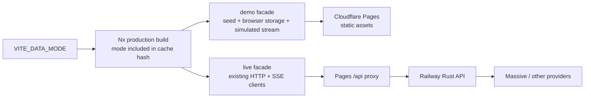
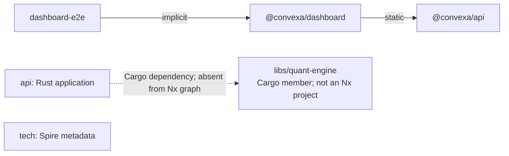

# Nx, production builds, tests, and deployment

Research snapshot: **2026-10-07 (America/Los_Angeles)**, commit `8932fc1176543eff3fa826de6924e12ec52f3310`.
The opening sections preserve the implementation-research snapshot. The portfolio demo has since been implemented locally; the current receipts below supersede earlier pending statements. They describe the worktree before its checkpoint commit, not a deployed hash. They do not claim hosted deployment or CI.

## Decision

Ship the portfolio as a **static demo on the existing Cloudflare Pages site**, with `VITE_DATA_MODE=demo|live` selecting a typed frontend data facade at build time. Demo providers own synthetic market data, portfolio persistence, research data, and simulated streams. Demo must work with all backend endpoints blocked. Keep the existing live API and provider contracts available for a future paid-data return.

Vite replaces `import.meta.env` constants during the build. Consequently, changing `VITE_DATA_MODE` requires rebuilding and redeploying; it cannot change an already-uploaded static bundle. Never place provider secrets in `VITE_*` variables. Keep `--mode production` for both demo and live so both receive production optimization. [Vite environment variables and modes](https://vite.dev/guide/env-and-mode).

## Implementation update: production environment and bundle evidence

The sandboxed Nx investigation initially failed while inferring the Vite target, and the inferred target allowed development `NODE_ENV` to reach the production build. Disabling plugin isolation in the approved inspection/build context exposed the inference issue. The resolved production target now pins `NODE_ENV=production`; both the `build:dashboard` wrapper and direct Nx production builds use that target. The wrapper validates and sets `VITE_DATA_MODE` before starting Nx. See the checked-in [build wrapper](../../tools/build-dashboard.mjs), [Nx target configuration](../../nx.json) and [Vite build config](../../apps/dashboard/vite.config.mts). The installed Nx plugin is an implementation dependency, not a remote documentation source; no `node_modules` path is used as a source citation.

The final production bundle guard reported 54 checks across 47 JavaScript files with the existing caps unchanged. The final four-step matrix passed: forced-fresh demo (8.3940503 s), identical demo cache hit (5.5964124 s), forced-fresh live (7.9684713 s), and demo restored from cache (5.5890235 s). “Fresh” uses `NX_SKIP_NX_CACHE`, not a naturally empty cache. Demo/live mode hashes were `18087900803837621755` and `3739905099639827135`; the restored demo public and private maps matched their original demo outputs. Each mode contains six canonical seeds; demo output has 196 public files and 47 private files. Invalid explicit mode failed before Nx (exit 2), and the forbidden public fixture/map scan returned no match (exit 1 by design). See [matrix evidence](evidence/demo-build-matrix.json).

The final static boot closure is 223,650 bytes Brotli q11 (218.408 KiB), compared with the original 196,143-byte (191.546 KiB) baseline. Technical Analysis adds 2,411 bytes and Research adds 1,675 bytes in the static graph. This graph is not observed network transfer. The complete boot is larger than the baseline; the result does not establish an entry-only performance gain. See [boot closure evidence](evidence/demo-boot-closure.json). Mode is selected by build environment and requires rebuilding to change.

Final local browser evidence includes the DEMO production G1 journey (54.159 seconds, zero egress) and an MSFT source expansion probe (60 unique sources, exit 0). The joined dashboard suite passed 262 files / 3,150 tests; API passed 8 files / 59 tests. Typecheck, generated API contract, format, and lint across three projects exited 0; lint had advisory warnings. Live Chromium passed 128/128 and compatibility 15/15. Accessibility execution passed 35/35 but retained seven unwaived moderate findings (five missing-H1 ticker findings and two heading-order findings on Positions). Visual baseline review remains pending and independent QA of 20 criteria is running. CI and hosted Pages checks have not run. See [joined local checks](evidence/joined-local-checks.json), [final accessibility receipt](evidence/live-accessibility-final.json), and the [atlas reading guide](README.md).

## Verified baseline

| Local measurement | Result | Exit |
| --- | --- | --- |
| `node --version` | 26.7.0; matches `.nvmrc:1` | 0 |
| `npm --version` | 11.17.0 | 0 |
| `npm exec --no -- nx --version` | Local 23.1.1; no global CLI | 0 |
| Installed package metadata | Vite 8.2.0; Vitest 4.1.11; TypeScript 5.9.3; Playwright 1.62.1; React 19.2.8 | 0 |
| `rustc --version` / `cargo --version` | Both 1.97.1 | 0 / 0 |
| Resolved dashboard config, outside sandbox | Build inputs `production,^production`; output `{projectRoot}/dist`; 261 inferred per-file `test-ci--*` targets | 0 |
| `npm exec --no -- nx graph --print`, outside sandbox | 5 projects; 2 internal dependency edges | 0 |

Commands above are probes, not application tests. No build, unit suite, browser suite, or remote deployment was run for this research memo.

The first sandboxed `nx show project @convexa/dashboard --json` exited 1 with `Missing Platform Dependency`. The native package was present and loaded directly with exit 0. Disabling native-file caching exposed SWC's `Access is denied` while canonicalizing `C:\Dev\convexa`; that retry exited 1. The same read-only Nx inspection outside the sandbox exited 0. **Do not reinstall dependencies or rewrite the lockfile to fix this sandbox-only failure.** Nx may need the same approved execution context for builds.

The installed `nx-workspace` skill was located and read before Nx graph inspection at `C:/Users/rodri/.claude/plugins/marketplaces/nx-claude-plugins/skills/nx-workspace/SKILL.md`. No Nx MCP tools were exposed in this session; official web documentation was used instead.

## Keep the good existing setup

| Existing behavior | Source evidence |
| --- | --- |
| Nx infers Vite, Vitest, TypeScript, ESLint and Playwright tasks; build dependencies run first | `nx.json:18`, `nx.json:74` |
| Production minification, ES2022 output, hidden sourcemaps, React/router/MUI splitting | `apps/dashboard/vite.config.mts:45`, `apps/dashboard/vite.config.mts:65` |
| Production postprocessing removes public sourcemaps and creates Brotli/gzip siblings | `apps/dashboard/package.json:11` |
| Hard Brotli budgets already exist: entry 22 KiB, React 60, MUI 110, router 20, ticker 50, positions 40, scanner 16, any JS asset 120 | `tools/check-dashboard-bundle.mjs:41` |
| Existing check rejects a charts dependency in PositionsPage | `tools/check-dashboard-bundle.mjs:227` |
| HTML revalidation and immutable hashed assets | `apps/dashboard/public/_headers:17` |
| Browser runner can serve built dist, refuses stale server reuse, retains failure traces | `apps/dashboard-e2e/playwright.shared.config.ts:23` |
| Explicit browser gates are uncached despite the broad global e2e default | `apps/dashboard-e2e/project.json:14`, `apps/dashboard-e2e/project.json:55` |
| Separate frontend/backend CI jobs, locked npm install, pinned Actions, full Git history, cancellation of obsolete runs | `.github/workflows/ci.yml:15`, `.github/workflows/ci.yml:32`, `.github/workflows/ci.yml:135` |
| Rust uses thin LTO and one codegen unit; backend container is stripped, static musl, nonroot scratch | `Cargo.toml:19`, `apps/api/Dockerfile:60`, `apps/api/Dockerfile:74`, `apps/api/Dockerfile:88` |

The bundle checker measures **Brotli**, although several Vite/CI comments still say gzip. Correct the comments when touching those files; do not silently change the actual metric.

## Priority changes before demo deployment

### 1. Make cached artifacts correspond to their actual inputs

The resolved dashboard target confirms that root postprocessing scripts and provider mode are absent from its explicit build inputs. Add project-specific inputs for `VITE_DATA_MODE`, `ANALYZE`, the Node runtime version, and `tools/archive-sourcemaps.mjs` / `tools/precompress-dashboard.mjs`. Add any future build-time seed selector or public API-origin variable when introduced. Include tracked fixture files through normal project inputs. Nx supports environment and runtime inputs; ignored `.env` files must not be assumed to participate automatically. [Nx input reference](https://nx.dev/docs/reference/inputs).

Do this at the dashboard target/named-input level rather than making Rust rebuild whenever a browser-mode variable changes. Inspect the **resolved** target after editing; global `targetDefaults` can replace useful plugin-inferred inputs (`nx.json:74`). Avoid restricting external dependencies to just one test/lint executable if transforms, plugins, React, or jsdom can change behavior.

`archive-sourcemaps.mjs:47` writes timestamped archives outside `dist`, but the resolved build caches only `dist`. A cache hit therefore cannot restore that build's private debug artifacts. Prefer deterministic `sourcemaps-private/current` plus a deterministic manifest as a declared private output; publish/upload that artifact separately. Alternatively keep archival as a separate uncached packaging operation. Do not cache all historical archives. Explicit `outputs` determine what Nx restores. [Nx project configuration](https://nx.dev/docs/reference/project-configuration).

The four-step matrix has been recorded in [evidence/demo-build-matrix.json](evidence/demo-build-matrix.json). Its forced-fresh steps bypass cache reads; they are not natural cold-cache timings. Keep the sequential mode switch because both builds write the same dist directory. The final G1 zero-egress assertions cover the restored local demo artifact behavior.

### 2. Make the demo build a small, honest artifact

Keep page-level lazy loading and lazy-load research/technical-analysis modules plus their seed data. Prefer a small shared symbol registry and deterministic per-symbol generation to hundreds of embedded full option chains. Keep user-visible synthetic provenance and seed time together with each result. Avoid a static import that puts the entire demo dataset or chart library into the landing page.

Measure the built landing page and each important route: initial compressed bytes, imported chunk graph, route increment, JS requests, and zero API/provider requests in demo. Add budgets only for the new sizeable route/data chunks after measuring them. Do not inflate the existing caps simply to make a build green. Existing chunk-name budgets can miss total route weight and data duplicated across chunks.

Vite 8 documents `build.rolldownOptions` and `output.codeSplitting`. This checkout still uses compatible `rollupOptions/manualChunks`; defer that mechanical migration unless a measured build problem warrants it. Current docs also describe dynamic-import load-error handling for old tabs across deployments. [Vite production guide](https://vite.dev/guide/build).

### 3. Use affected selection only after dependency coverage is proven

Use the last successful main revision as `NX_BASE`, with full Git history, for frontend affected tasks; retain a full release validation. Nx documents this base to cover changes since failed CI runs, not just the immediately preceding commit. [Nx affected CI](https://nx.dev/docs/features/ci-features/affected).

The graph has no quant-engine project and no dependency from Rust `api` to it. `apps/api/project.json:24` uses `nx:run-commands` with caching disabled, and `Cargo.toml:3` includes both crates. Before routing Rust checks through affected/caching, declare Cargo workspace manifests/lockfile, quant-engine source, API config/static assets, build scripts, toolchain, target triple, and relevant build flags as inputs, or keep explicit backend path detection. Do not claim Nx understands Cargo automatically.

Retain Cargo's cache initially. Do not cache a whole `target` directory through Nx merely to turn `cache` on. Docker builds currently omit `--locked` (`apps/api/Dockerfile:42`, `apps/api/Dockerfile:60`) while CI includes it (`.github/workflows/ci.yml:232`); fix that when backend packaging is next changed.

### 4. Bound concurrency; avoid paying for another service

Use one Nx task graph for independent frontend lint/typecheck/test/build work with a measured worker ceiling, rather than serial npm wrappers. Nx supports task parallelism while respecting dependencies. [Nx running tasks](https://nx.dev/docs/features/run-tasks). Start with a conservative machine limit and avoid multiplying Nx task workers by Vitest workers. CI already caps Vitest at two workers (`.github/workflows/ci.yml:71`).

A static demo does not require Nx Cloud, distributed agents, another database, an LLM service, or a Rust deployment. Use current npm/Cargo caches and local Nx caching first. Evaluate more caching only from measured CI time. Keep tasks that use real services, timing, or external state uncached.

Backend CI currently runs expensive release capacity work and two `cargo clean` calls (`.github/workflows/ci.yml:199`, `:205`, `:228`). These are existing runtime guarantees; do not remove them casually to make a frontend demo faster. A dedicated frontend demo artifact/release path can avoid requiring them for every static upload while existing backend checks stay intact. Thin LTO already trades extra linking time for optimization; no evidence here justifies adding fat LTO or PGO. [Cargo profiles](https://doc.rust-lang.org/cargo/reference/profiles.html).

## Economical test design

Use existing Vitest and Playwright infrastructure; do not introduce a second browser framework or coverage quota. The resolved dashboard already has **261** inferred per-file CI test targets. This count is configuration, not 261 tests executed.

| Risk that could ship silently | Cheapest durable guard |
| --- | --- |
| Demo accidentally calls a paid/live endpoint | One production-build browser journey records/blocks `/api`, external fetches, EventSource and WebSocket; visits ticker, scanner, portfolio, technical analysis and research |
| A facade returns the wrong live DTO shape | Typecheck against shared API types plus focused provider contract fixtures for representative success/empty/error states |
| Portfolio loses edits or pollutes live state | One store round-trip/reset/version test; a demo-specific storage namespace; a browser reload check in the main journey |
| Indicator calculations invent unavailable history or have wrong offsets | A few known-vector tests for each actual formula, including warm-up/null periods and flat series; no screenshot tests for math |
| Refresh/deep-link fails after static deployment | One direct navigation per new route against built dist and the deployed URL |
| Mode switch restores wrong cached output | Once-recorded Nx cache matrix above; a durable build assertion only if the failure is otherwise silent |
| User perceives synthetic data as live | Assert persistent demo indication and synthetic as-of labels in the core browser journey |

Use accessible role/name locators and web-first assertions, isolated contexts, traces on failures, and a conservative browser worker count. These align with [Playwright best practices](https://playwright.dev/docs/best-practices) and [Playwright CI guidance](https://playwright.dev/docs/ci). Preserve existing compatibility/accessibility/visual gates; avoid adding duplicate snapshots for every seeded widget. Review once for documentation, chunk arrangement, and low-risk copy changes rather than adding permanent tests.

## Existing hosting and release path

| Target | Evidence and consequence |
| --- | --- |
| Cloudflare Pages, named `convexa.pages.dev` in source | `apps/dashboard/public/sitemap.xml:5`; `.github/workflows/deploy-smoke.yml:5`. Source configuration is confirmed; current remote availability/account permissions are not checked here. |
| Pages edge proxy | `functions/api/[[path]].ts:54` reads `API_ORIGIN`; `:81` fetches Railway. Public operator metrics/research paths are blocked at `:44`. Demo must never enter this path. |
| Railway API | `railway.json:13` auto-runs `api-rust postgres-migrate`; `:14` probes `/api/health`. **Do not deploy Railway for the static demo:** schema/data migration requires Rodrigo's separate chat authorization. |
| Container fallback | Frontend nginx image exists (`apps/dashboard/Dockerfile:25`); Node 24 there differs from local/CI 26.7.0. Keep toolchain alignment as a future packaging fix, not a reason to replace Pages. |

Release procedure: build demo with explicit mode; typecheck and run the focused checks; record bundle measurements; verify the built artifact with the backend blocked; publish the tested dist to the existing Pages project; open the final URL and deep links; confirm demo provenance and zero API traffic. Verify Pages project branch/build settings before deciding whether to use its Git integration or an authenticated direct upload. Direct upload accepts prebuilt assets; existing Git-integrated projects can also receive manual deployments. [Cloudflare Direct Upload](https://developers.cloudflare.com/pages/get-started/direct-upload/) and [Pages CI upload](https://developers.cloudflare.com/pages/how-to/use-direct-upload-with-continuous-integration/).

Keep demo packaging explicit so the root `functions/` directory is not accidentally bundled into a supposedly static-only artifact. Preserve the live proxy in the repository for live deployments. Existing `deploy-smoke.yml` checks real API/scanner behavior; create a mode-aware demo smoke path instead of treating absent live market data as a broken demo.

No external accounts, credentials, paid plans, DNS, schema, data, or deployment were changed during this research. Remaining release blockers are implementation/verification and confirmation of existing Pages access/settings from the actual account; they are not reasons to buy live data.

## Deployment options: feature-branch investigation

Follow-up on 2026-10-07: the existing Pages Git integration is a practical route to a publicly accessible demo **without a new vendor or Cloudflare token**. Git was rechecked: remote `ariasr47/convexa`, branch `codex/portfolio-demo-platform`, HEAD still `8932fc1176543eff3fa826de6924e12ec52f3310`. The following read-only GitHub API and HTTP commands all exited 0; no push, PR creation, deployment, CI edit, or account change occurred.

| Verified remote record | Evidence |
| --- | --- |
| Current main commit already has a successful Pages deployment | Check run `113094197626`, completed **Oct 7, 2026 17:55 PDT**; deployment `3fcfc468-a794-4c45-b4cc-f1802581f643`, project `convexa`; [deployed commit URL](https://3fcfc468.convexa.pages.dev). |
| A recent feature branch was deployed independently | [PR 75](https://github.com/ariasr47/convexa/pull/75), head `4507fd6`, branch `spire/v4-install-2026-09-22`: Pages success at **Oct 7, 17:53:57 PDT**, deployment `e6379ccb-20f1-4c48-9e5f-6ed3819ea9c3`. Both [deployment URL](https://e6379ccb.convexa.pages.dev) and [branch URL](https://spire-v4-install-2026-09-22.convexa.pages.dev) returned **HTTP 200**, `text/html`, from Cloudflare on fresh HEAD requests. |
| A second feature branch confirms the pattern | [PR 73](https://github.com/ariasr47/convexa/pull/73), head `6107963`, branch `test/pg-simultaneous-serve-flake`: Pages success, deployment `e4f73b9a-7fb5-4f28-b114-406dfdbff12a`, with a branch preview URL in the check body. |
| Those two feature heads did not have recorded Railway deployments | GitHub combined-status responses contained zero statuses; GitHub deployments queries filtered to each SHA returned **0 records**. Main `8932fc1`, by contrast, has successful `convexa - api-rust` status and production deployment `6924479272`. This establishes historical behavior, not the current Railway account's complete settings. |

Cheapest mechanism: retain Pages' existing Git integration and use the repo's documented build entry, **`npm run build:dashboard`** (`docs/CLOUDFLARE_PAGES_SETUP.md:32`). Replace its implementation with a small versioned outer Node wrapper when authorized build work begins. The wrapper should validate an explicit `VITE_DATA_MODE` first; when unset, choose `demo` only if `CF_PAGES=1` **and** `CF_PAGES_BRANCH=codex/portfolio-demo-platform`, otherwise choose `live`. It must pass that explicit value in the child environment **before launching Nx**, and propagate the child's exit code. A dedicated explicit demo script should remain usable locally. This preserves normal live defaults and lets a future environment-variable change override the branch default deliberately.

Cloudflare injects `CF_PAGES` and `CF_PAGES_BRANCH` into Git builds and documents branch-dependent scripts as a supported approach. This proposed wrapper applies that mechanism through the existing npm entry instead of requiring a new dashboard command. [Pages build configuration](https://developers.cloudflare.com/pages/configuration/build-configuration/) and [branch-specific build commands](https://developers.cloudflare.com/pages/how-to/build-commands-branches/).

Release sequence for this feature: finish the joined local G1 journey and independent QA; create a **draft PR** from the feature branch; wait for CI and the Pages preview tied to that exact PR head SHA; run hosted deep-link checks there; then report the preview URL and evidence. Do not merge to `main` or deploy Railway for the static demo. Railway main deployment runs a predeploy migration, and schema/data migrations require separate authorization. A Pages preview is the review target; it does not establish production deployment. Confirm `demo` from the built mode receipt and browser behavior; a successful Pages check alone proves neither mode nor feature correctness. Feature previews leave production domains unchanged. Read the exact preview URL from the check instead of guessing its sanitized alias. [Pages previews](https://developers.cloudflare.com/pages/configuration/preview-deployments/).

Before that push, review the diff against Railway's watched paths (`railway.json:4`): `apps/api/**`, `libs/quant-engine/**`, `Cargo.toml`, `Cargo.lock`, `railway.json`. This static demo should touch none of them. Do not merge to main merely to obtain a demo URL; the main commit evidence shows an active production Railway integration, and its predeploy command performs a migration.

| Remaining uncertainty or blocker | Consequence / fallback |
| --- | --- |
| Actual remote build command and preview branch filters are not visible through GitHub checks | The npm entry is documented in source but is not remotely confirmed. Historical previews work, yet an exact new branch could be filtered. Pages supports all/none/custom preview filters. If the new check is absent, inspect account settings instead of claiming deployment. [Branch controls](https://developers.cloudflare.com/pages/configuration/branch-build-controls/). |
| No working Cloudflare account session/token was established by this investigation | Direct upload and account-setting edits are not currently proven available. Git integration can still operate using its existing GitHub authorization. The parent investigation observed the dashboard login screen; that observation was not independently replayed here. |
| A new Wrangler file would take ownership of project configuration | Do not invent a `wrangler.toml` to bypass unavailable dashboard settings. Cloudflare recommends downloading the existing configuration before adopting the file; its Pages reference configures Functions bindings/output, and does not establish a replacement for the dashboard's Git build command. [Wrangler Pages configuration](https://developers.cloudflare.com/pages/functions/wrangler-configuration/). |
| Git preview may still package the preserved root `functions/` proxy | Zero API requests from the demo browser must be verified. If the approved design requires the deployed preview itself to refuse direct `/api/*`, add a separate demo-aware edge refusal or explicit static packaging step; merely avoiding frontend fetches does not disable the deployed proxy. |

Direct upload remains a fallback after Cloudflare authentication becomes available: deploy the tested static artifact to the **existing** project with an explicit nonproduction branch. There is no demonstrated need to create another project or purchase a plan. Promoting the portfolio to the production Pages domain is a distinct release action; this investigation establishes the lower-risk preview route first.

### Static demo routing follow-up

Cloudflare's [Pages Functions routing documentation](https://developers.cloudflare.com/pages/functions/routing/) (read October 7, 2026; page updated September 18) puts `_routes.json` in the build output and gives `exclude` precedence over `include`; wildcards cover nested paths. From those documented rules, the demo-only output `{ "version": 1, "include": ["/*"], "exclude": ["/*"] }` excludes every route from Functions invocation. This configuration is an inference from the documented matching rules, not a copied vendor example. Preserve the existing live output's routing and verify the hosted demo artifact/direct routes. No new Cloudflare account, service, credential or Wrangler project configuration is needed for this packaging change.
