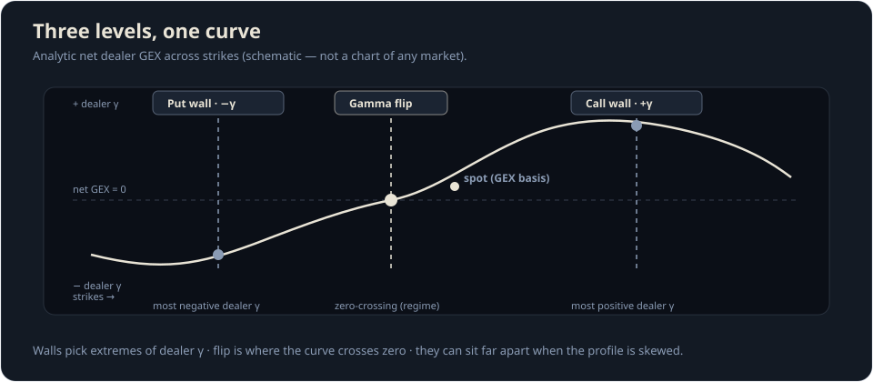
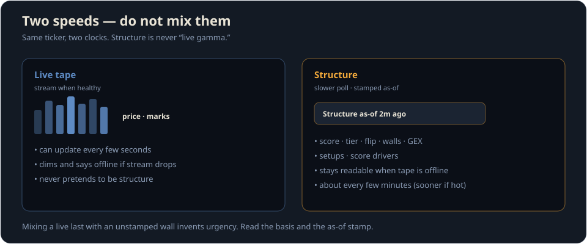

# How We Read Dealer Structure

_Walls, the gamma flip, GEX, score, and two data speeds — what Convexa actually computes, on what basis, and where the read is weak._

---

## Not a crystal ball

Convexa is an **analysis desk**, not a forecast machine. The numbers you see are a structured read of **options dealer positioning** from a chain snapshot: call and put walls, the gamma flip, net GEX across strikes, and a plain additive opportunity score.

We do not invent direction on the frontend. Structure is computed on the server from the option chain. The browser maps labels and layouts — it does not re-score a scan row into a different truth.

> Simulated trades are paper. A connected brokerage is read-only. Nothing here places, changes, or cancels a real order. This is not investment advice.

---

## The objects on the desk

Three levels matter most on liquid names:

1. **Call wall** — the strike with the largest **positive** dealer gamma under our open-interest sign convention.
2. **Put wall** — the strike with the largest **negative** dealer gamma under the same convention.
3. **Gamma flip** — the zero-crossing of the **analytic net-GEX curve** across strikes: where hedging behavior flips from dampening to amplifying moves.

Walls and flip are related, not the same object. A skewed gamma profile can put walls far from the flip. Treat the flip as a regime boundary and the walls as concentrated gamma levels — not as a single “support/resistance” cartoon.

### Dealer sign is a convention

Walls use the vendor’s per-contract gamma and a **dealer-sign open-interest convention** (calls short / puts long as the default dealer book). That is a **snapshot convention**, not measured inventory. Real desks can and do differ. When gamma or OI is missing, the tile says unavailable — we do not invent a wall.

### GEX: raw dollars vs vol-normalized

**Raw GEX** sizes exposure for a fixed **1% spot shock**. Useful for absolute magnitude of the book.

**Vol-normalized GEX** divides that magnitude by ATM IV (or 30d HV if ATM IV is missing) so readings stay comparable when vol is high or low. Independent evidence favors the vol-normalized magnitude as a cleaner structural read; **walls and flip stay raw strike levels**. Vol-norm GEX is **not** a scoring input today — it is advisory context on the ticker.

---

## Spot basis: which price the structure sits on

GEX and walls are computed at a **GEX spot basis** — often the cash/session close when the market is closed, live mid during regular hours under the engine’s phase rules. The ticker always labels that basis so a structure level is never confused with the live tape price.

If you compare a wall to the streaming last without reading the basis, you will invent a gap that is not there.

---

## Two data speeds — do not mix them

**Live tape** (prices, marks when the stream is healthy) can update from a stream.

**Structure** — score, tier, flip, walls, GEX, setups — refreshes on a slower poll (about every few minutes, sooner for names that just moved). The scanner and ticker say **“Structure as-of …”** for that path on purpose.

When the live stream drops, live tiles dim and say offline. Structure tiles stay readable at their last snapshot. A quiet tape is not a blank desk. A structure poll is not “live gamma.”

---

## Score and tier (what the number is)

Opportunity score and tier arrive **pre-computed from the server**. The frontend maps closed labels (Prime, Actionable, Watch, Dormant) and never re-derives the score from scan rows alone.

The score is a **capped sum of plain components**:

| Component | Cap | What it rewards |
| --- | --- | --- |
| Proximity | 40 | Nearness to walls / flip |
| Vol stretch | 25 | \|IV/HV − 1\| richness or cheapness |
| Setups | 25 | Active structure setups |
| Flip transition | 10 | Within a flip proximity band |
| Dark-pool confluence | 6 | Optional off-exchange overlap |

The scanner “why this row” tip surfaces the top components when the server sends `score_drivers`.

### Honest scope

Today’s score does **not** consume vol-normalized GEX or the IV-rank band. Those packs are **advisory context on the ticker only**. Folding them into the score is a deliberate product change that needs a scored feature and ledger evidence — not a quiet UI tweak.

---

## Where the read is weak

- **Liquid index and megacap names** are the strong case. Thin single names can show structure that is noise; the ticker shows a single-name caveat outside the curated universe.
- **Outside regular hours**, structure still ages honestly, but spot basis and chain freshness matter more.
- **Missing chain data**, a failed symbol, or a building first pass shows as unavailable or building — never a fabricated zero.
- **Vendor gamma can lag or gap** on thin names. OI sign remains an assumption.
- **Sim P/L** uses a mark ladder (snapshot → modeled → theoretical → last known). Last known is frozen when the stream is offline; it is never framed as live.

---

## What Convexa never does

- No real order path — no place, change, or cancel at a broker.
- No guarantee — structure is context for a plan, not a price forecast and not a trade command.
- No silent score invention on the client — if the server did not send a score, the UI does not invent one from neighboring rows.

---

## Want the short in-product version?

The product page [How Convexa works](/methodology) is the same spine, kept next to the desk. This post is the longer, public version of that honesty.

Open the [Scanner](/scanner) or free [Ticker](/ticker) and read structure as-of the stamp — not as a live prophecy.
