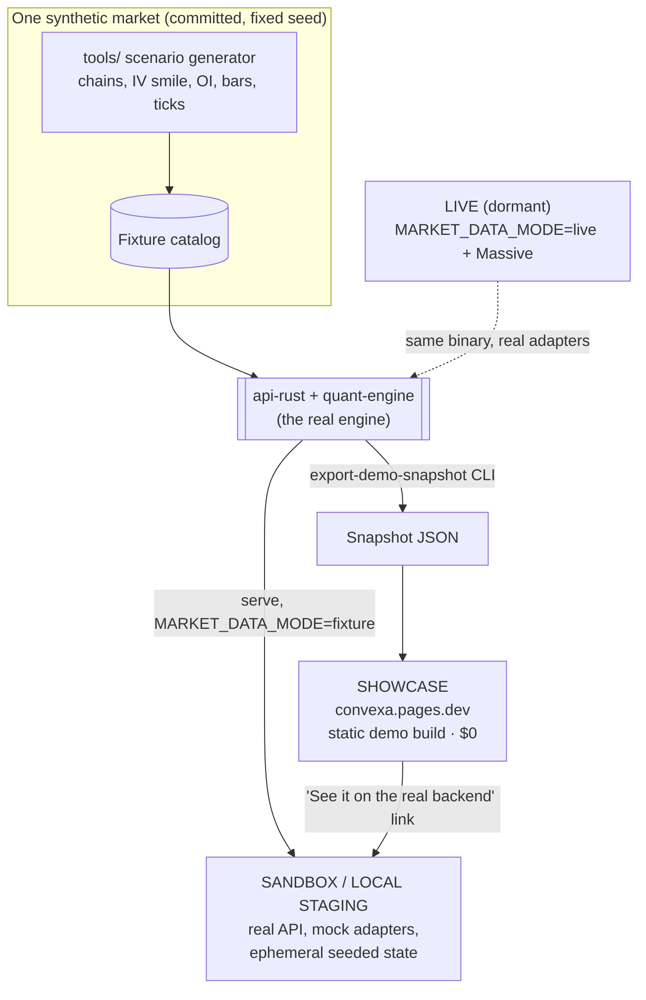

# Convexa as a portfolio piece — environment design (proposal, 2026-10-12)

Status: **proposal**, not decided. Companion to `AUDIT-2026-10-12.md` (what exists and what's missing).
Evidence marks: **measured** (a command or metric I read), **published** (a vendor's price page or a 2026 guide),
**inferred** (my reasoning, not run).

## 1. What the portfolio has to prove

Convexa's rare strengths, in the order a reviewer would care:

1. **Domain depth** — a dealer-gamma (GEX) engine in Rust (`libs/quant-engine`): walls, flip, vol-normalized GEX,
   signals. Few portfolios have real quantitative code.
2. **Systems design** — Axum/Tokio API, a two-speed data model (streamed tape vs polled structure), SSE streams,
   a scanner loop, fail-closed production guardrails, serialized migrations, rate limiting.
3. **Contract-first API** — the Rust OpenAPI export generates the TypeScript client; a check fails on drift.
4. **Ports and adapters** — every outside dependency sits behind a swap point. This is the project that the
   mock work would turn from claim into demonstration.
5. **Frontend craft** — React 19 terminal UI with its own design system, accessibility and bundle budgets.
6. **Engineering judgment** — risk-based testing, paused-data mode, the honest "sample" labelling everywhere.

And one story most portfolios lack: **the data vendor went away, and the system was re-architected to stay fully
demoable on a synthetic market through the same engine.** That is a postmortem with a design answer.

## 2. Who looks, and for how long

| Audience | Time | What they need | Served by |
|---|---|---|---|
| Recruiter | 1–2 min | A link that loads instantly, looks real, and says what it is | Showcase |
| Hiring manager / engineer | 5–15 min | README, architecture, one deep dive, proof the backend is real | Showcase + atlas + API reference (+ sandbox) |
| Interviewer, live | 30–60 min | You driving the real stack, changing an adapter, explaining tradeoffs | Local staging |
| Future you | — | A runbook to switch real data back on | Live (dormant) |

## 3. Design principles

1. **The resume link must work for years.** Only a static site survives free-tier changes, cold starts and bills.
   Everything else is optional depth layered on top.
2. **Same engine, different adapters.** The demo's numbers come from the real Rust engine run over a synthetic
   market, never from hand-authored outputs. This is the proof of point 4 above, and it fixes realism.
3. **Every environment has a distinct job.** No environment shows the same thing as another.
4. **$0 floor.** Anything that costs money must buy a specific signal.
5. **One command to reproduce** each environment.

## 4. The four environments

| | Showcase (production URL) | Sandbox (hosted staging, optional) | Local staging | Live (dormant) |
|---|---|---|---|---|
| Job | Sell the product | Prove the backend is real | Interviews, development | Resume the product |
| URL | `convexa.pages.dev` | e.g. a second Pages project + Railway service | `localhost` | restored when resumed |
| Frontend | Demo build, static | Live build pointed at the sandbox API | Live build | Live build |
| Backend | none | `api-rust` in `MARKET_DATA_MODE=fixture`, `APP_ENV=staging` | same, via compose | `api-rust` live + Postgres |
| Market data | Snapshot exported from the engine | Synthetic market, computed live | same | Massive (paid) |
| Accounts | Demo visitor (browser) | Real sign-up, ephemeral, reset on sleep | seeded demo user | real |
| AI | Exported sample reads | Mock provider through the real pipeline | same | user's own key |
| Broker | Sample holdings | Stub provider through the real route | same | real adapter (none today) |
| Cost / month | $0 | cents (see §6) | $0 | Massive + Railway |
| Fails how | Can't, short of Pages going away | Cold start; free-tier change | — | — |

Key sequencing insight: the **snapshot export is a CLI, not a server mode.** It reuses the capacity harness's
fixture state constructor (`capacity/harness_app.rs:75-110`, inferred adequate) to run `compute_analytics` over the
fixture catalog and write JSON. So the showcase's realism fix does not depend on building or hosting the sandbox.

## 5. What each environment adds for a reviewer

| Signal | Showcase | Atlas + API ref (static) | Sandbox | Local staging |
|---|---|---|---|---|
| Domain depth (GEX math) | ✔ numbers from the real engine | ✔ source-linked | ✔ | ✔ |
| Product/UI craft | ✔ | | ✔ | ✔ |
| Contract-first API | | ✔ browsable OpenAPI | ✔ live calls | ✔ |
| Ports and adapters | ✔ "under the hood" panel | ✔ diagrams | ✔ same binary, mock adapters | ✔ swap live in an interview |
| Real auth, persistence, SSE | | | ✔ | ✔ |
| Ops judgment (guardrails, throttle, paused mode) | | ✔ | ✔ (429s, refusal in prod) | ✔ |

## 6. Cost

**Today (measured, Railway metrics over 7 days, 2026-10-05 → 12):** `api-rust` averages 8.7 MB RAM (max 24 MB),
~0 CPU. Postgres averages 182 MB RAM, 1.14 GB disk. At Railway's published rates ($10 per GB-RAM-month, $20 per
vCPU-month, $0.15 per GB-month storage) that is about **$2.10 a month of usage**, almost all Postgres. The Hobby plan
is $5 a month and includes $5 of usage, and the account also hosts five other projects. So Convexa's *marginal*
cost is roughly $2 of shared credit, possibly $0 off the actual bill. **Not measured: the invoice** — check
Railway's billing page before deciding N3 on cost grounds.

**Options (published rates; usage estimates inferred):**

| Option | Monthly | Notes |
|---|---|---|
| Showcase only (Pages) | $0 | Static; durable |
| Sandbox on the existing Railway project, Serverless (sleep after 10 min idle), no Postgres | ≈ $0.01–1.50 of usage | Replaces the paused API. Fixture-mode memory is unmeasured; even 150 MB always-on is ≈ $1.50. Asleep costs no compute. First request after sleep is slow and may 502, so the frontend must show "waking the engine" |
| Sandbox on Fly.io | ≈ $1.94 always-on (shared-cpu-1x 256 MB); cents if stopped | New accounts may get no free allowance |
| Sandbox on Google Cloud Run | likely $0 inside the free tier | Request-based billing charges while an SSE stream is open; new account and setup |
| Cloudflare Containers | $5 Workers Paid plan minimum | Not worth it here |
| Live again | Massive subscription + Railway | Out of scope while dormant |

The real cost is **your time**, not money (sizes in §8).

**Recommendation on hosting:** if you host a sandbox, convert the existing Railway `convexa` project rather than
adding anything: same platform as live, same Dockerfile, Postgres removed (it is most of today's usage, and its
private-network traffic would keep a sleeping service awake). Take a `pg_dump` first.

## 7. Risks and mitigations

| Risk | Mitigation |
|---|---|
| Snapshot and engine drift apart | Snapshot carries the scenario id and engine commit; one cheap check in `verify` re-runs the export and compares a hash |
| Public sandbox abuse | Ephemeral memory stores, reset on sleep; sign-in throttle (already shipped); cap accounts; mock AI only (no LLM spend); refuse real AI keys and broker credentials in staging |
| Visitors paste real API keys | Sandbox and showcase show "simulate connect" with no input fields |
| Fixture mode leaks into production | Refused when `APP_ENV=prod`, with a test proving the refusal |
| Free tier or platform changes | Showcase never depends on the sandbox; the sandbox link degrades to "offline, here's a video" |
| Scope creep on a dormant project | Tiered plan (§8); stop after any tier |
| Vendor data licensing | Synthetic market only; recorded Massive data stays private (N5) |

## 8. Plan by value per effort

**Tier 1 — highest value, small (S each):**
- Production shows the showcase (owner sets `VITE_DATA_MODE=demo` for Production and Preview; then delete the
  branch hard-code in `tools/build-dashboard.mjs:16`).
- Phase 1 fixes from the audit (demo clock, contradictions, "coming soon", 422s, flake).
- README top rewritten for 30 seconds: one GIF, the live link, three "technically interesting" bullets, the
  architecture diagram. Replace the stale `0c9f45c7` preview link.
- Publish the backend atlas (static, no fetches) and an API reference rendered from
  `apps/api/openapi/convexa.openapi.json` on the showcase site.
- Repo hygiene a reviewer notices: Dependabot PRs, dead workflows, 23 MB `visual-review`.
- Write the vendor-loss postmortem as the second blog post.

**Tier 2 — the credibility fix (M–L):**
- Synthetic market generator + `export-demo-snapshot` CLI; reseed the showcase from it.
- Produced AI reads with strikes and exit plans, through the real panel.
- A short guided tour (landing → GEX desk → AI read → act → position → scanner) that explains GEX in plain words.
- An "under the hood" toggle showing which adapter served each panel.

**Tier 3 — interview depth (M–L):**
- Backend fixture mode (`serve`), synthetic ticks, mock AI provider, boot seeding, compose `demo` profile.
- Optional: host it as the sandbox on the converted Railway project; link it from the showcase.
- Record a 90-second video of local staging for the README (durable even if the sandbox goes).

## 9. Open decisions

- Host a sandbox at all, or local staging + video only?
- How to present the AI-agent delivery system (`.spire`, `.claude`, `.codex`, `.grok`, 236 MB on disk). Reviewers
  will ask. Recommended: keep it, explain it in "How this is built" as a process you designed and gated, and be
  ready to defend any line of code.
- N1–N5 and D5–D9 from the audit stand.

---

## Decision — 2026-10-12 (owner), supersedes §4 and §6's hosting recommendation

The owner chose **two hosted environments with opposite jobs**:

- **Production** (`convexa.pages.dev` → Railway `production`): the live build. Market data stays off
  (`MARKET_DATA_MODE=paused`), and every market surface shows a deliberate, consistent "live data is off" state.
  **Research works for real**: the owner's own ticker research flows into the Research tab. Railway production
  (API + Postgres) stays; N3 ("stop Railway") is withdrawn.
- **Staging** (hosted, e.g. `staging.convexa.pages.dev` → Railway `staging` environment): completely demoable on
  mock data — mock market data, ticks, AI and broker, seeded sample research. Never touches production data.

Proposed wiring (not yet built):

| | Production | Staging |
|---|---|---|
| Pages | Production env, branch `main` | Preview env, branch `staging` (PR previews also land here) |
| Pages build | `VITE_DATA_MODE=live` | `demo` until fixture mode exists, then `live` |
| Function `API_ORIGIN` | Railway production | Railway staging |
| Railway | `api-rust` paused, `APP_ENV=prod`, Postgres | `api-rust` `MARKET_DATA_MODE=fixture`, `APP_ENV=staging`, Serverless sleep, no Postgres (seeded in memory) |
| Research | owner's real research | seeded sample research |

Open: how research is written (repo markdown vs in-app editor), who can read it, the work order, and whether the
repo (currently PRIVATE) becomes public for reviewers.

## Decision — 2026-10-12 (owner): research

- Research is written as **Markdown files in the repo** and built into the site on push. No backend change.
- It is **public** on the production site.
- Order: **research first, then the production paused-state polish**; staging runs on the browser demo meanwhile.

## Decision — 2026-10-12 (owner): research freshness and updates

- **Notes are never kept current.** Each stays true as of its date. The reader's browser works out its state
  (Current, Review due, Superseded, Archived) from the note's own dates; the pre-push check never reads the clock.
- **Updates start from the previous note as the starting view and checklist, never as a draft.** Facts are looked up
  again, carried analysis is re-confirmed before publishing, and judgments move in logged steps. A fresh note from
  the blank template when a kill criterion fires, the price leaves the bear-to-bull range, the business changes
  shape, or 4+ quarters pass.
- Rules, states and planned tooling: `docs/research-method/README.md`. Design: the canvas's Freshness board.

## Decision — 2026-10-14 (owner): no mocks in production, a demo account on staging

Settles the open question from 2026-10-13 (which environment carries the semi-live, semi-mocked hybrid): neither
environment mixes them.

- **Staging is a demo account.** A completely mocked web app on seed data, presented as a signed-in demo account.
  Nothing on staging calls the API or a third party.
- **Production is the portfolio site.** Nothing is mocked. Every feature that needs the Massive feed shows its
  component state (not live) instead of sample data. Everything that works without Massive is live: public data
  (Treasury, CFTC, FINRA, SEC), TradingView's chart, research notes, and whatever can be computed from those.

Supersedes the 2026-10-13 plan to fill Massive-dependent widgets with sample data on the live build.

## Decision — 2026-10-14 (owner): the Lab and the landing art in production

- **Lab:** in production each Lab instrument shows its not-live state, with a link to the same instrument
  running on sample data on the staging demo. (The Lab draws dealer structure, which needs the Massive feed.)
- **Landing illustrations** stay in production as labelled illustrations ("Illustrative sample"): they explain
  the product and are not presented as data.
